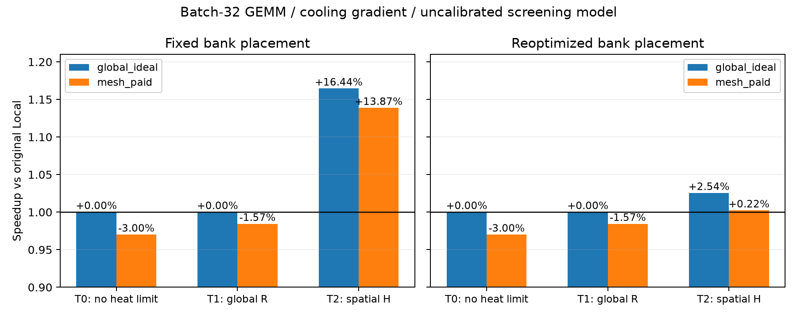
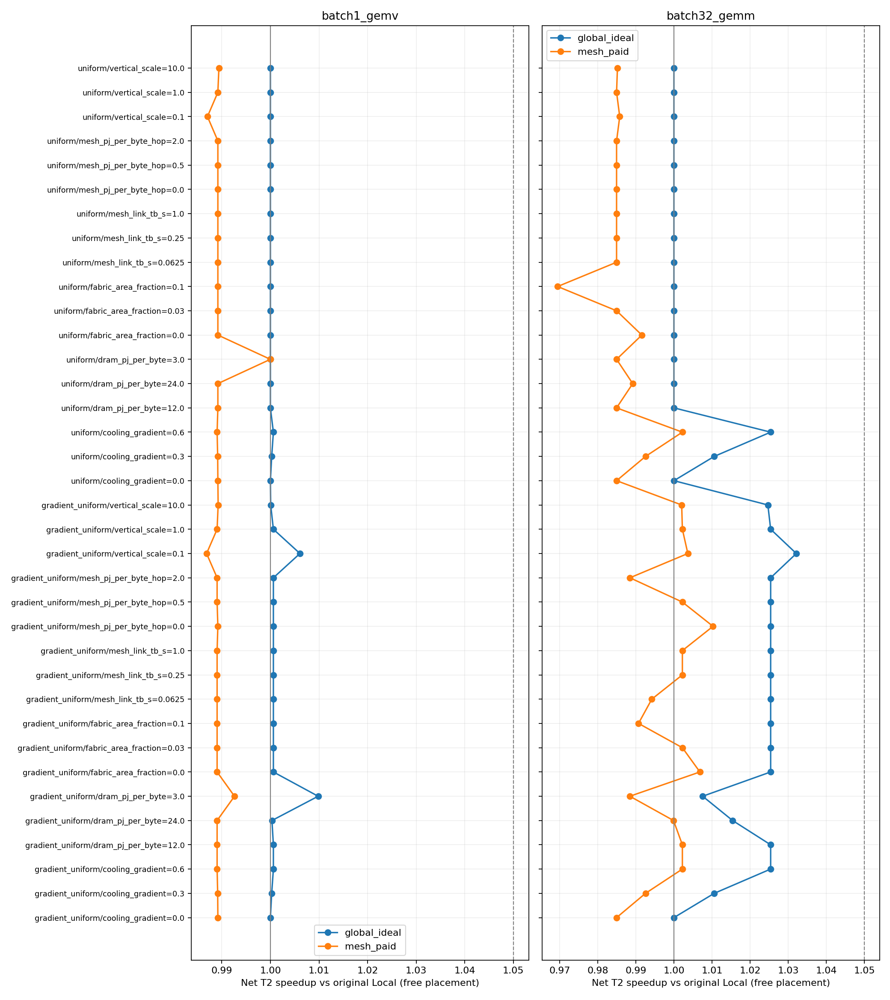

# 首轮实验：当前证据不足以支持新 Compute–Memory Fabric

结论：在这个未校准的 chip-scale 稳态筛选模型中，空间热反馈确实能放大固定数据布局下的非局部访问收益。
但是，给予 Local 基线相同的数据放置优化机会后，绝大部分收益消失；计入新增 Fabric 开销后剩余净收益很小。
因此，当前应当优先检验 Mapping/data placement，不进入新 Fabric 的 RTL 设计。
这不是对所有 HB 设计的否定，也不是对真实 WoW wafer-scale 的实验结论。

## 执行与预算

代码版本：`2913b2c`；HiTS 版本：`c7f94d533cb663c2f098880e5ab333da9d83ff17`。
在用户指定的实验服务器完成；服务器没有检测到 NVIDIA GPU，使用 HiTS CPU GMRES。
源代码从已推送的 Git commit 通过 bundle 同步到干净、隔离的 checkout，计算输出存放在源码目录外。
GitHub 仓库为 **public** `HaoningJiang-space/thermal_exploartion`。
发布前检查了全部追踪文件和 Git patch history，未包含登录文件中的账号、地址或密码；原始运行日志保留在源码之外。

16 Tiles + 16 Bank Groups，Logic 下/DRAM 上，再接被动散热层。
HB 峰值总带宽 16 TB/s；Compute 总峰值 256 TFLOP/s；每 Tile 私有 SRAM 1 MiB。
所有这些参数以及 DRAM/Logic 能量、bond/TIM 和散热参数均是明确的实验假设，没有器件校准。
冷却梯度场景的顶层 convection 从一侧 0.4× 到另一侧 1.6×，总导热预算保持不变。
这个人为设置用于测试机制，不代表已测量的实际冷却不均匀性。

Pilot：180 个独立优化设计点。Sensitivity：2160 个设计点。
每点枚举三种访存 chunk/row-miss 假设，共求解 **7020 个 LP**。
矩阵实验同时包含 T0/T1/T2、固定与可优化数据放置、Local/Neighbor/Global/Mesh 和匹配预算 Local。
敏感性扫描采用单因素方式，共 36 个场景实例，包含重复控制点，不能视为 36 个统计样本。

## 默认冷却梯度下的关键结果

Batch-32 GEMM，空间热约束 T2：

| 数据放置 | 原始 Local TFLOP/s | Global ideal TFLOP/s | 付费 Mesh TFLOP/s | 理想收益 | Mesh 对原始 Local 的净收益 |
|---|---:|---:|---:|---:|---:|
| Fixed | 55.9584 | 65.1603 | 63.7171 | +16.44% | +13.87% |
| Free，各自重新优化 | 66.5891 | 68.2801 | 66.7370 | +2.54% | **+0.22%** |

Local 仅通过重新优化 Bank 数据份额，从 55.9584 增至 66.5891 TFLOP/s，已经超过固定布局下的 Global ideal。
因此，固定布局下的 +16.44% 不能证明传统连接边界是软件无法消除的瓶颈。
Free placement 之后，付费 Mesh 相对同面积/静态功率预算的 Local matched 收益为 +1.61%；
相对无需增加 Fabric 的原始 Local 只有 +0.22%。两种比较必须同时保留。

T0 下原始 Local 的 GEMM 峰值为 256 TFLOP/s，付费 Mesh 因预留 3% 面积而为 248.32 TFLOP/s（−3%）。
T1 下付费 Mesh 对原始 Local 为 −1.57%。T2 的 Free placement 小幅净提升构成该假设模型内的弱反转，
但远未达到事先设置的 5% 跟进门槛；不能把它写成已经建立新的 Architecture Design Principle。

Batch-1 GEMV，Free placement 后，Global ideal 仅 +0.061%，付费 Mesh 净退化约 1.10%。
付费解选择零远端访问：在该工作点，连接成本超过可恢复的热收益。

均匀负载、均匀冷却时，理想共享收益为零（数值误差范围内），符合对称性负对照。
中心负载偏斜的 GEMM 在 Fixed 下存在较大的无热收益，重新放置数据后消失，属于普通资源不平衡信号。

## 敏感性扫描没有找到强 B 证据

Free placement、整个扫描范围内：

| 工作负载 | 理想 Global 对 Local 的最大 T2 收益 | 付费 Mesh 的净收益范围 |
|---|---:|---:|
| Batch-1 GEMV | +0.98% | −1.31% 至 0% |
| Batch-32 GEMM | +3.21% | −3.05% 至 +1.03% |

GEMM 的付费最大净收益 +1.03% 出现在链路动态能量设为零的理想控制点，仍保留默认面积及静态功率开销。
扫描覆盖 vertical coupling ×0.1/1/10、链路 0.0625/0.25/1 TB/s、链路能量 0/0.5/2 pJ/B/hop、
Fabric 面积 0/3/10%、DRAM transfer energy 3/12/24 pJ/B、冷却梯度 0/0.3/0.6。
结果没有覆盖这些参数的任意组合；不能外推为完整全空间上界。

自动 `B_candidate` 行全部来自 Fixed placement；**Free placement 中没有任何行通过 5% 净收益门槛**。
自动标签只是筛选提示，最终判断仍须检查对照公平性与模型边界。

## 数值验证与保留证据

HiTS 提取所有单位功率响应，每列经过其原方程 acceptance。
39 个场景实例 × 32 个源列 = 1248 次 HiTS solve；最大相对残差约 `9.93e-12`。
与 SciPy sparse direct response 的最大绝对差约 `2.86e-11 K/W`。
这些是数值一致性证据，不能验证封装、功率或架构参数的真实性。

实验版本的 7 项回归在本地和远端通过；新增两项队列/零链路容量边界回归后，最终 9 项在本地和远端全部通过。
完整命令、版本、exit codes 和未执行项见 [verification.json](verification.json)。
源代码通过 `git diff --check`。未运行 native HotSpot/3D-ICE 或 CUDA thermal benchmark；本任务也没有提出 GPU 加速性能结论。

- [Pilot 全表](pilot/report.md)、[标量结果](pilot/results.csv)、[运行版本](pilot/provenance.json)
- [Sensitivity 全表](sensitivity/report.md)、[标量结果](sensitivity/results.csv)、[运行版本](sensitivity/provenance.json)
- [HiTS 数值对照](sensitivity/thermal_validation.json)、[原始文件哈希](raw_manifest.json)

完整逐流 Mapping/DVFS/power/temperature 原始 JSON 和日志保留在服务器及本地 `outputs/remote-evidence/`，没有挑选删除负结果。
LP 可能存在多个同样最优的 Mapping；单次求解器选择的远端比例或温度图不能证明该 Mapping 是唯一必要组织。

## 后续方向

先校准局部与跨层热响应、网格收敛和 DRAM 访问能量；若设备实际支持远端服务，校准其面积、能量及事务延迟。
然后加入多算子的共同数据容量和布局迁移成本、真实 Transformer/MoE 轨迹、瞬态热反馈及 refresh/leakage。
只有在这些约束导致 Local 的强 Mapping 基线无法恢复性能，而且有限局部 Fabric 仍有稳定净收益时，才继续硬件设计。

文献边界与公平对照参见 [文献核对](../../docs/literature.md) 和 [研究方案](../../docs/research_plan.md)。
Tasa 已研究热分布与 bandwidth sharing，[Tasa 原文](https://arxiv.org/html/2508.07252)；
Voxel 已有跨 core request grouping，[Voxel 原文](https://arxiv.org/html/2604.26821v2)；
DeepStack 的主要 DSE 使用全局 R，[DeepStack 原文](https://arxiv.org/html/2604.04750)。
这些重叠进一步要求本项目证明连接组织发生实质性的最优性变化，当前实验尚未做到。
