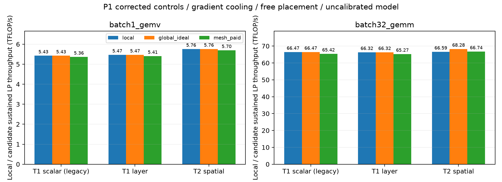

# P1 审计修正：计算结果保留，对照和分类更正

**已增加 T1_layer，修正架构 Gate，并在原 Linux 环境重跑相同的 Pilot、原敏感性配置和 G2。Compute–Memory Fabric 正式关闭的决定不变。**
没有新增 Fabric 参数点，也没有修改 HiTS。原 G1/G2 归档完整保留，旧 T1 标量和旧 B_candidate 标签只能按历史规则解释。

## 两项修正

T1_layer 从同一空间响应 H 提取 2×2 层平均热阻，保留 Logic/DRAM 两种功率来源和独立温限，移除横向位置。
输出保持 0/1/2 的旧模式含义，新增 3=T1_layer，并附 thermal_model 名称。
空间交互改为 T2/T1_layer；旧 T2/T1_scalar 比值和 scalar→layer 差异另行记录。

新标签区分 fixed_placement_signal、ideal_upper_bound_signal、architecture_candidate。
架构 Gate 必须包含完整布局控制、优化后的可用布局、付费连接开销，T2 相对原始 Local 及匹配 Local 的收益均 >5%，
T0/T1_layer 净收益 <=1%，T2/T1_layer 净交互 >1%。只在 fixed 或独立布局 oracle 下有收益，不能通过。
即使通过，也仍须验证执行时序、物理成本和新颖性。

旧 G1 自动分类中 **58 个 B_candidate 全部来自 Fixed Placement**；修正版三个套件的架构 Gate 通过数为 **0**。
新的 fixed_placement_signal 共 61 个，其中包含旧分类未列为 B 的固定布局收益；这个标签不表示 Thermal 架构证据。

## 复现与新增对照

执行提交 `a69116b57cc80d5f3a332c7179f2115722286f45`，干净 checkout，HiTS 仍为 `c7f94d533cb663c2f098880e5ab333da9d83ff17`。
240 Pilot + 2880 原敏感性 + 864 G2，共 3984 个设计点、10512 个 LP。
本地和 Linux 均有 29 项回归通过，包含两层温限、层平均匹配、源层区分及分类误报回归。

公共旧 CSV 与新 CSV 的 2988 个共同设计点比较：

| 套件 | 共同设计点 | 吞吐/周期时间最大相对差 |
|---|---:|---:|
| Pilot | 180 | 7.77e-16 |
| 原敏感性 | 2160 | 1.44e-15 |
| G2 | 648 | 8.88e-16 |

G2 全部周期净收益上界差为 0；Shared 最大布局时间损失仍为 1.231%，理想 Global 最大周期净收益上界仍为 2.975%，付费 Mesh 仍为 0.715%。
新增层对照后，288 个 Migration 设计点仍全部选择零搬运。它们是模型内的条件上界与最优 LP 结果，不是实测性能。

默认冷却梯度、Free Placement 的 Local 结果：

| 工作负载 | T1 scalar TFLOP/s | T1 layer TFLOP/s | T2 TFLOP/s | 将 T1_layer 功率代回 H 的 Logic 热点 |
|---|---:|---:|---:|---:|
| Batch-1 GEMV | 5.4270 | 5.4705 | 5.7588 | 105.38°C |
| Batch-32 GEMM | 66.4686 | 66.3224 | 66.5891 | 93.57°C |

T1_layer 匹配均匀层功率下的平均温度，并非任意非均匀功率下的热点上界。
T2 可以把工作重新分配到散热较好位置，所以这些控制并非简单嵌套，Local spatial penalty 可以为负。
表中 T1_layer 的空间热点超过 85°C，进一步说明层平均预算也不能代替实际空间温限。
模型对照差异不能单独证明实际硬件需要新拓扑。

## 数值与架构验证的边界

1312 次 HiTS 单位热源求解，最大原方程相对残差 9.93e-12，与 SciPy direct 最大响应差 2.86e-11 K/W。
这些只验证已组装线性方程的数值求解；封装材料、功率、时序和连接成本仍未物理校准。

G2 只覆盖一份共同权重、两个合成 Kernel 和可连续分割的分片。
理想广播/归约、连续 DVFS、周期级 DRAM/NoC/Controller 依赖、多 tensor 生命周期与温度相关 refresh/leakage 仍有缺口。
此次没有把这些建模缺项误称为已修复的执行语义。

复核脚本：`python scripts/verify_audit_replay.py --replay results/audit-p1-2026-10-09 --output outputs/replay-check.json`。
只需公开仓库中的 CSV，不依赖未公开原始 Mapping。
证据：[版本与数值复核](replay_verification.json)、[测试](regressions.log)、[归档验证](verification.json)、
[Pilot](pilot/report.md)、[原敏感性](sensitivity/report.md)、[G2](g2/report.md)。
完整原始文件及日志保留在原服务器与本地 outputs/p1-remote-evidence，哈希见 manifest 和 verification。

后续只进入 [HB–DRAM 内部供数分析](../../docs/memory_audit.md)；Thermal-aware Mapping 留作基线，不恢复 Fabric 分支。
