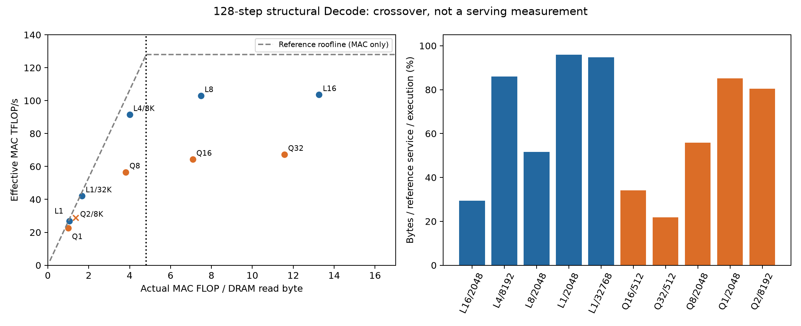
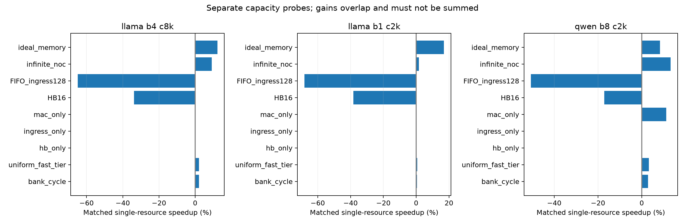
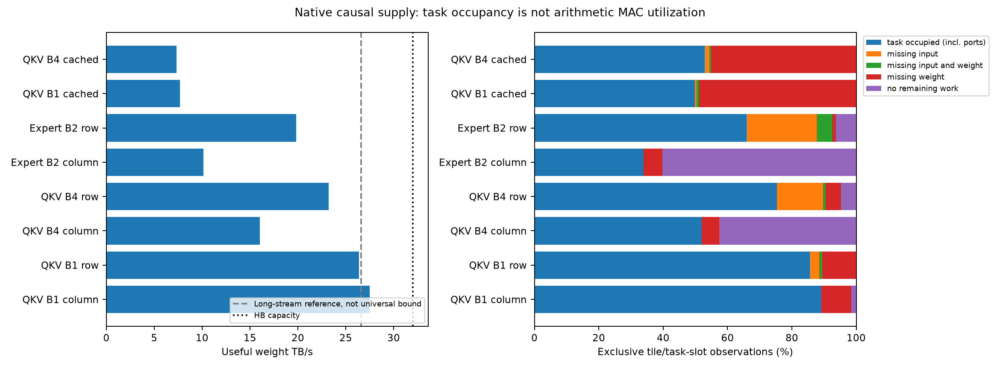
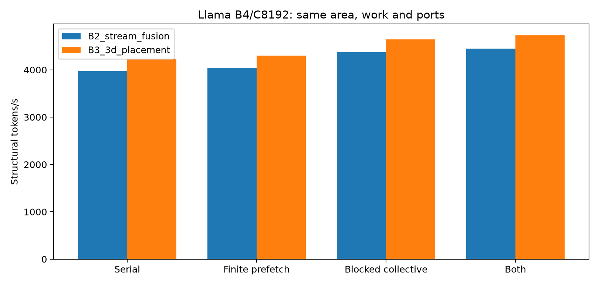
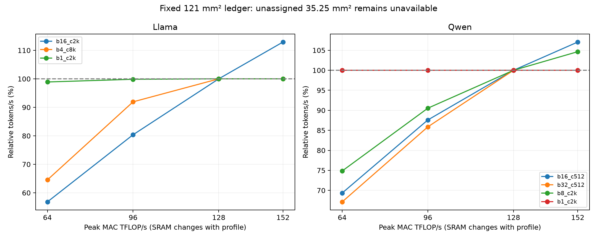
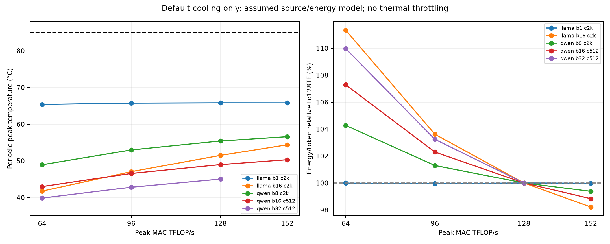

# Compute–Memory–Communication Architecture Crossover

**Research Go：已观察到计算–供数需求的交叉及资源前沿变化。Hardware Go：尚未建立。**
本轮没有提出新Fabric/Peripheral/NoC，不推进RTL。结果不支持将整个HB架构方向关闭；也不能把常规MAC/SRAM面积交换称为新的3D架构。

主执行冻结在`2bb172c`，额外NoC/Memory Oracle及默认热评价在`6bf1571`，独立审计与初始导出在`61922c8`。
[实验合同](../../docs/crossover_architecture.md)区分论文参数、工程假设和理想上界。
所有成功点均实际执行128步；275个归档点中185个通过工作量/资源账目，90个有限调度或面积配置失败，失败没有被删掉。
另有8个长流命令参考、12个详细kernel、19个默认热评价点。测试113项通过，测试数量不构成器件真实性证据。

## 1. Architecture Crossover Map

固定121mm²、32GiB DRAM、16Tiles/256Banks、128TFLOP/s、36MiB SRAM、32TB/s HB和每方向32GB/s Mesh。
使用与原参考接近的26.599TB/s服务guard；独立重跑为26.5990939TB/s，未依据完整模型延迟拟合这个值。
下表每点均在B2/B3的冻结布局和四种合法有限调度中选择最快结果。数据供给下界是**当前fluid guard模型的条件下界**，不是所有DRAM访问的物理定理。

|场景|平均每步μs|实际MAC FLOP/B|供数条件下界/实际时间|结构化tokens/s|
|---|---:|---:|---:|---:|
|Llama B1/C2048|599.266|1.054|95.91%|1668.71|
|Llama B1/C32768|765.980|1.668|94.80%|1305.52|
|Llama B4/C8192|845.614|4.000|85.98%|4730.29|
|Llama B8/C2048|1252.149|7.485|51.72%|6389.01|
|Llama B16/C2048|2489.526|13.265|29.36%|6426.93|
|Qwen B1/C2048|228.504|0.999|85.13%|4376.30|
|Qwen B8/C2048|731.151|3.814|55.78%|10941.66|
|Qwen B16/C512|1211.147|7.083|34.14%|13210.62|
|Qwen B32/C512|2315.495|11.568|21.87%|13819.94|
|Qwen B2/C8192 **context-extension control**|440.589|1.354|80.39%|4539.38|

临界强度为128/26.599≈4.812FLOP/B。新增Llama B8/B16和Qwen B16/B32明确覆盖计算侧。
Llama B1若不改变实际读取字节和guard，消除其余全部开销的吞吐空间只有约4.26%；这不能被一个大IdealMemory数字替代。
较大Batch的低下界占比也不等于全部剩余时间都可恢复：还包含必需计算、局部端口、集合通信与合法依赖。

### 路由与容量

这次使用[原始Qwen1.5 checkpoint](https://huggingface.co/Qwen/Qwen1.5-MoE-A2.7B/tree/1a758c50ecb6350748b9ce0a99d2352fd9fc11c9)采集的128×32×24层路由，60Experts/top4，包含Shared Expert与三投影gated MLP。
[公开capture](../../configs/routing/qwen15_matched_capture.json)和压缩记录可独立复用。
采集为CPU FP32；架构存储为BF16，未证明BF16 top-k逐位相同。32组公开主题提示是受控输入，不是生产负载。
不同Batch取同一步的前B个Token，步长始终32，不循环复用Decode记录。独立四组Prefill提示产生placement prior，未用Decode作训练。
B1/B8的C2048等是C512路由的**上下文转移敏感性**，不能当作对应Context重新捕获的真实推理。

新增四个场景含128步KV增长的总常驻量为17.145、19.270、28.603、30.478GiB，均通过32GiB及区域/Tier容量检查。
所有Tier仍各有固定容量，未把全部权重免费放入Fast Tier。Qwen B2/C8192+128超原配置上下文边界，始终单列控制。
这里只模拟结构、工作量和依赖；tokens/s不是实测Serving速率，也没有数值LLM正确性声明。

## 2. Memory Service Breakdown

单项反事实匹配最快**已测试**布局和调度，保持有效MAC、DRAM/HB字节。
表中百分比是各自相对基线的吞吐变化，不能相加；HB16及FIFO128是降低资源的负向控制。

|只改变的限制|Llama B1/C2K|Llama B4/C8K|Qwen B8/C2K|
|---|---:|---:|---:|
|Tier bank-cycle ceiling，保留共享guard|+0.57%|+2.08%|+2.85%|
|均一Fast Tier时序，保留实际容量/字节|+0.65%|+2.10%|+3.24%|
|HB串行化等待|0%|0%|0%|
|FIFO写入串行化，保留FIFO读端口|0%|0%|0%|
|MAC算术时间，保留操作数端口|0%|0%|+11.16%|
|Infinite NoC|+1.68%|+9.22%|+13.23%|
|Ideal DRAM/HB Delivery，**保留FIFO读端口**|+17.00%|+12.27%|+8.30%|
|HB32→16TB/s|-38.34%|-33.75%|-17.10%|
|FIFO写入500→128B/tick|-68.17%|-64.90%|-50.62%|

**关键解释：**默认32TB/s HB及FIFO ingress尚有余量，去除单项等待没有收益；大幅缩窄则变成真正瓶颈。
bank-cycle probe没有删除D1 guard中的全部ACT/PRE/controller限制，零或小收益不能证明这些成本不存在。
MAC-only保留权重消费端口，消除算术并不等于获得免费无限消费能力。
这次补齐FIFO读写500B/tick的明确预算；旧Stage大IdealMemory Oracle未收取同样的FIFO消费速率约束，数值不能直接比较。
本轮IdealMemory仍突破原DRAM服务率，**不是新硬件可实现收益**；它也没有把FIFO读端口变成无限大。

### 独立详细命令与端口观测

|相同QKV6144×4096输入|Cached Row|FIFO Row-K|FIFO Row-M|FIFO Column64|
|---|---:|---:|---:|---:|
|B1 有效权重TB/s|7.696|26.379|27.697|27.507|
|B4 有效权重TB/s|7.322|23.229|21.186|16.033|

Cached路径存在16×512GB/s普通SRAM写入口上限；已知FIFO消费路径另付成本，不能把cached7.7TB/s误判为DRAM阵列的能力。
Qwen down矩阵2048×1408/B2的Row/Column为19.818/10.140TB/s；小kernel及归约/输入依赖不能用统一长流标量精确预测。
Column64的B4 QKV为3.13925μs，改成全局归约屏障为5.18225μs：已知流式集合通信确实重要，并非一个新NoC的证据。
所有上述事务都有端到端ID、原生ACT/PRE/RD/Refresh状态及时序重放；12个案例的独立逐flit FIFO/queued+inflight credit重放通过。
实际每ACT平均有效字节约4096，cached因Refresh约4090.7；没有把Row Conflict能耗伪装成已校准数据。
MAC task-slot的`occupied`包括等待操作数端口的占用，不能当成每周期算术MAC活动率。回压计数允许重叠，不能直接相加。

8个1GiB命令参考保留原时序恢复约束。共享接口baseline26.599、双Subarray代理29.416、激进行周期Oracle29.661TB/s；Oracle相对代理只剩0.83%。
把同256Banks的两个服务域分成独立命令接口，baseline仅26.986TB/s；不增加容量、实际HB或队列元数据预算。
这仍是已有机制/接口假设的代理，不是新的SALP电路、Stratum复现或已实现硬件。

## 3. Optimized Execution Baseline与资格边界

已加入有限邻接阶段Prefetch、64-row结果就绪后归约、Megatron式配对gated FFN、输入复用、受工作空间约束的Expert cohort与增量累加、两块64-row logit扫描。
重叠时MAC和Collective分别占现有256B/tick SRAM读端口的一半，写端口共用128B/tick；FIFO/返回/路由credit始终有限。
Expert身份只能在实际路由完成后用于Prefetch；全局RMS、Attention及Layer依赖保留。
Llama B4最快已知有限调度相对重新选布局后的Serial提高12.07%。
Qwen的非Serial模式同时启用cohort增量累加，因此不能把它的全部变化单独归于Prefetch。
这些是[SET/SoMa/DeepStack机制适配](../../docs/crossover_architecture.md)，**不是完整上游优化器复现，更不是全局最优调度证明**。

独立H2–快速kernel对照保留同MAC/DRAM字节、输入NoC byte-hops及资源预算，未添加经验拟合。

|案例|快速相对原生延迟误差|10%目标|
|---|---:|---|
|QKV B1 Row-K|+4.04%|满足|
|QKV B1 Row-M|+9.23%|满足|
|QKV B4 Row-K|**+19.86%**|**不满足**|
|QKV B4 Row-M|+9.31%|满足|
|Qwen down B2 Row-K|**+11.34%**|**不满足**|

快速模型保留整段输入分发屏障、32KiB/register-reuse tile；原生执行器可边到达边消费128/88元素组，且保留不同partial SRAM访问与地址顺序。
这些差异已记录，**不能挑Row-M通过就宣布所有大Batch预测合格**，也不能把屏障误差当成必须改硬件的损失。
本轮完整模型前沿是可复现的条件性架构结果，绝对延迟资格仍有限。TP16统一分片也尚不能替代充分优化的EP/TP混合或HDA-MoE强基线。

## 4. Architecture Design Frontier

85.75mm²已计费面积之外的**35.25mm²冻结为不可用**。
MAC+Matrix RF18.96544mm²一起缩放；Row-swap RF4.8726592mm²固定；Psum+Shared11.9279232mm²按20%固定外围/80%容量缩放。
Vector、NoC、controller、banks/HB不变。152TF/18MiB全部计费面积119.78485mm²，在storage phi0.4时仍可行；详细ledger含phi0/0.2/0.4。
192/24、192/6、256/12是冻结预算下的失败对照，未免费使用RF、端口或未知面积。

|场景|152TF/18MiB相对128TF/36MiB|判断|
|---|---:|---|
|Llama B1/C2K|0%|供数主导，多MAC无益|
|Llama B4/C8K|0%|权重消费/供数与通信仍限制|
|Llama B16/C2K|**+12.92%**|计算侧资源交换有价值|
|Qwen B1/C2K|0%|额外MAC无益|
|Qwen B8/C2K|+4.65%|混合计算/通信压力|
|Qwen B16/C512|**+7.06%**|部分软件调度可在小SRAM运行|
|Qwen B32/C512|失败|本轮cohort/shared-partial工作空间不足|

Qwen B16的部分Serial小SRAM方案失败，但有限累加调度可恢复；B32尚失败。
**这不是18MiB硬件不可能运行B32的证明**：普通row-blocked partial accumulation仍可能恢复，也不是增加Buffer的新硬件动机。
已看到同固定面积下最合适的资源比例随Batch与数据复用改变。它与TETRIS/ATLAS/DeepStack已有资源交换思想高度相关，尚未证明HB独有或新的硬件边界。

## 5. 默认Thermal与持续性能

只评价19个可行前沿点、同0.3K/W默认包级边界，未扩大Thermal DSE。
最大周期Logic峰值65.812°C，DRAM65.132°C；全部低于85°C，T0/T1_layer/T2均无需降速。
128步cold burst的采样峰值39.384–51.404°C，未用短活动直接冒充稳态。
HiTS最大原方程残差4.74e−12、相对SciPy Direct最大响应差5.74e−12K/W，周期平均能量平衡误差约4.33e−13K。
这些是数学/数值正确性；4×4等效层、Tier热深度、Logic memory heat fraction0.48、0.302pJ/FLOP和聚合3.432pJ/B均有假设边界。
新增能量没有把HB或完整ACT再收一次；未经识别的Refresh/Leakage温度反馈关闭。
TP16分片使Expert访问活动大体分布到16Tiles；真实Expert路由不自动意味着此布局已有空间Expert热点证据。

## 6. 研究决策与最值得追的边界

**Research Go保持。**本轮已经越过Roofline，并看到面积/工作空间前沿；同时把小Batch剩余执行空间收窄。
**Hardware Go未成立。**12.92%/7.06%是当前假设内的常规资源交换收益，不是经过详细执行资格确认的新硬件净收益。
Qwen B8保留13.23%的网络反事实信号，但需先排除EP/TP混合、合法输入消费与更强跨算子调度；当前没有证明必须改变NoC或计算单元。

下一项最有价值的证据应是：相同原始Qwen路由、容量和固定端口下，已知EP/TP、行分块累加和合法输入流式消费后仍剩多少关键路径损失。
在它被确认前，不新增Peripheral、Fabric、热参数扫描或RTL，也不以失败点否定整个HB研究。

## 7. 时钟审计更正与公开原始记录

本轮曾错误地把Python CK0.5ns当作原生tick，发布了“旧实验快一倍”的判断；**现已撤回**。
[上游serializer](https://github.com/CMU-SAFARI/ramulator2/blob/c6c7a5de0cef35935d6fad7369e6271406798865/python/ramulator/dram/spec.py)会将HBM3 timing counts乘2、tick period除2，原0.25ns执行换算是正确的。
新的generated-config独立检查和原生重跑均确认此点。旧发布数字未改动。
错误二分频命令实验及其衍生低service-guard快速模型保留为retired controls，**不进入主结论**；后者仅降低guard，并非每个Tier时序都完整翻倍。
原始旧标签和错误诊断来源也保留，不能将其名称当成当前认同的物理证据。

[公开Release](https://github.com/HaoningJiang-space/thermal_exploartion/releases/tag/crossover-execution-2026-10-11)包含主执行、详细命令和退役控制的三个原始包；manifest给出每个归档和条目SHA256。
压缩事件保持字节不变，机器路径替换为`<run-root>`。所有失败点、source commit、捕获记录及资格不满足项均保留。
