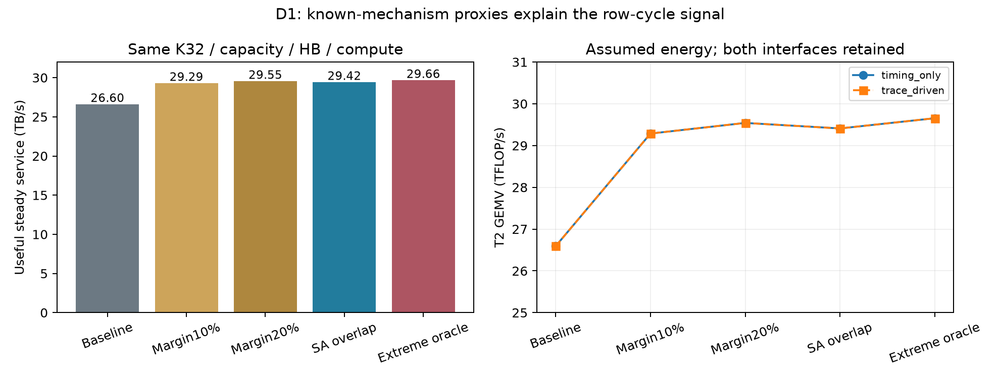

# D1：关闭 Row-cycle 新硬件分支

固定K32、256物理Banks、32 GiB、128 TFLOP/s、36 MiB SRAM、32 TB/s内部HB预算。
执行源码为`6d3fa03`，Ramulator为`c6c7a5de0cef35935d6fad7369e6271406798865`。
七组Linux命令实验完整执行5,767,168请求、9,439,008命令；84个LP保留T0、T1_layer、T2与两种能量接口。
这些是条件性架构模型结果，不是测量或Stratum器件复现。

| 固定K32机制 | 稳态有效供数 TB/s | tRAS / tRC ns | T2 GEMV TFLOP/s |
|---|---:|---:|---:|
| 原始时序 | 26.599 | 30 / 35 | 26.593 |
| 10%时序裕量假设 | 29.294 | 27 / 31.5 | 29.287 |
| 20%时序裕量假设 | 29.549 | 24 / 28 | 29.541 |
| 双Subarray重叠代理 | 29.416 | **30 / 35** | 29.409 |
| 历史激进Oracle | 29.661 | 6.5 / 11.5 | 29.654 |

双Subarray模型未缩短单行恢复时间；在同一个物理Bank的不同本地状态间观察到263,424次重叠ACT。
它恢复Oracle带宽增量的92.0%，Oracle相对它只剩0.83%；相对20%时序裕量假设只剩0.38%。
两条机制不同，不将时序裕量与Subarray overlap混称为SALP。
T2中所有full-row GEMM点仍为128 TFLOP/s，未出现新的空间热组织信号。
按预先规定的5%剩余潜力门槛，**停止Row-cycle新硬件探索，不进入RTL**。
该停止判断只适用于本轮固定K32/full-row模型，不声称已知技术在真实Mono3D器件中经过可靠性认证。

## 机制与公平性

[SALP §4–5](https://www.istc-cc.cmu.edu/publications/papers/2012/SALP-isca12.pdf)区分PRE/ACT重叠、
多Subarray激活以及MASA的显式选择。本轮是MASA-like机制代理：隐式Column选择、额外0.5ns首次访问延迟，
共同PC ACT/Column/命令和HB约束。没有实现完整SA_SEL协议，不能把软件重放PASS称为完整SALP验证。
每个Bank的行地址一分为二，不增加物理Banks、容量或Ports。
额外控制面积0.1815 mm²、静态功率0.01815 W、选择能量0.01nJ均为标记的假设，计入共同121 mm²预算。

[AL-DRAM](https://arxiv.org/html/1603.08454v1)提供器件与温度相关时序裕量的历史依据。
本轮10%/20%是独立的探索假设，**不是从DDR3导出的Mono3D安全时序**。
Oracle保留作历史探针；不把tRAS缩短约78%解释为可制造设计。

## 命令能耗接口修正

`organization.lp_config`不再覆盖传入的ACT密度。显式选择：

* `timing_only`：固定full-row访问能量，复现旧11.44%时序信号；接口记录其固定ACT密度。
* `trace_driven`：使用实际ACT、关闭行数量、RD/WR、Refresh和选择活动；删除额外reopen静态代理，避免重复计费。

系数的ACT/PRE划分、刷新及物理层分配仍是假设，尚无独立命令功率校准。
本轮full-row两种接口的性能一致，因为两者均未触发85°C限温；功耗结果并不相同。
trace-driven基线GEMV为Logic59.06W、DRAM52.43W、Logic热点67.07°C；重叠代理为64.59W、57.71W、71.21°C。

256 MiB partial-row控制每ACT只使用1024B：服务率由6.663升至7.879 TB/s。
相同字节活动下，DRAM动态系数从full-row约1.786 pJ/B增加到约3.843 pJ/B，证明实际ACT密度进入账目。
不能沿用full-row的免费能量假设评价未来部分行候选。

HiTS单位响应最大残差约9.92e-12，与direct最大差5.74e-12 K/W。
这仅验证48节点方程的求解，不验证材料参数或真实温度。粗空间模型没有表示8个独立热层。

## 证据和复现

[全部84点](all-points.csv)、[七组命令汇总](command-cases.csv)、[完整LP结果](summary.json)、
[停止判据](gate.json)、[原始执行版本](provenance.json)保留所有预设点与负结果。
运行：`python -m thermal_exploration.run_d1 --ramulator-root <pinned-root> --thermal-backend hits --output <fresh-output>`。
导出：`python scripts/export_d1_results.py --input <output> --output <fresh-archive> --raw`。

D2转向6 GiB真实访问工作集、同Bank多Tier时序、任务输入join和部分和依赖。
先判别优化Mapping/Prefetch后是否仍有执行损失；不继续Peripheral DSE、Fabric或G5闭环。
