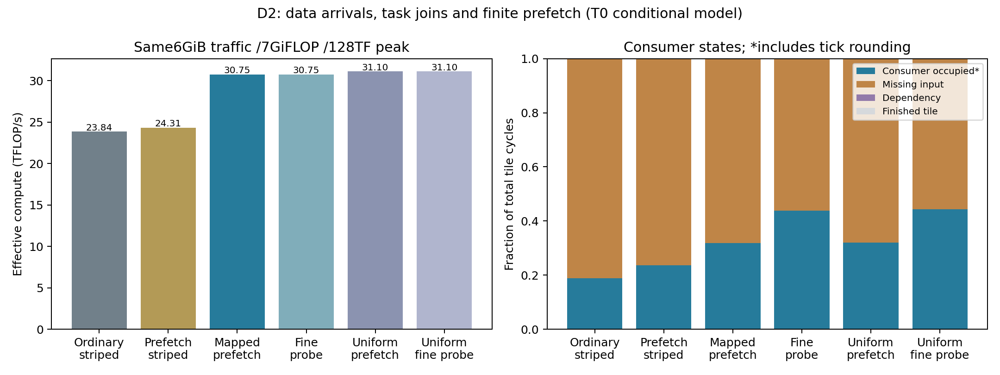
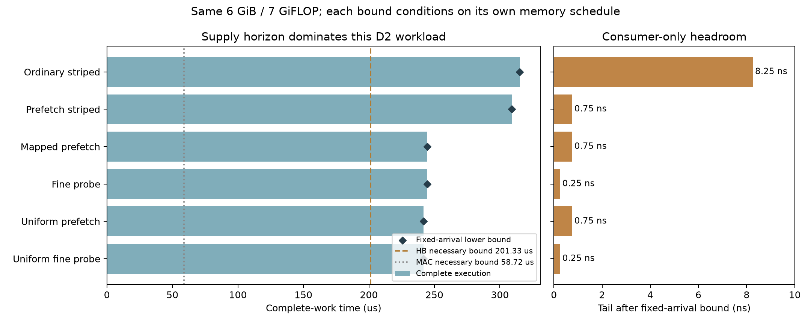

# D2：已知优化有收益，当前输入join不支持新硬件

**Hardware No-Go；Research Go限于执行归因与后续依赖型工作负载选择。** 优化静态布局、预取和就绪任务调度后，完整吞吐提高28.96%；
更细的流式消费探针只再增加约0.000205%。
等延迟负对照的相应增益约0.000207%，交互比为0.99999998。
没有发现足以支持本轮新输入消费单元的剩余join瓶颈，不推进该硬件或G5闭环。
这是当前受控工作量和硬件假设的判断，不是对所有多Tier NPU的最优性证明。
Research Go不表示已经发现新架构；它表示保留有解释力的归因结果，下一步重新选择依赖/计算交织的执行场景。
两级决策见 [research_decisions.md](../../docs/research_decisions.md)；不更改本轮冻结的5%与Tier交互筛选门槛。

## 真正跨Tier的工作量

16Tiles、128 TFLOP/s、256物理Banks、32GiB、36MiB SRAM与32TB/s HB预算固定。
每Bank32768行，八个时序Tier各4096行；不同Tier共享Bank状态、ACT域、Column和HB。
Tier-aware deadline扩展保留恢复约束，不生成八倍Banks。

每次实际读取5GiB FP16权重（10个`32768×8192`专家投影）与1GiB KV扫描/双归约代理。
KV段为2FLOP/B，投影为1FLOP/B，共7GiFLOP，所有方案完整完成。
KV归约完成才允许投影计算；已知权重地址允许提前预取。
4KiB/1024B投影任务保留16KiB输出行内的部分和依赖，不免费删除计算。
普通和优化执行拥有同一512KiB可用payload预算、2.25MiB SRAM/Tile；普通软件只用双缓冲128KiB。
输入广播、跨Tile KV归约、SRAM端口和MAC利用条件均为共同理想化假设。

compact布局把1GiB KV+3GiB权重放入fast Tier，另外2GiB权重放入下一Tier。
命令验证确认4,194,304次fast Tier读取和2,097,152次次快Tier读取，不能把6GiB免费装入4GiB。
striped布局均匀访问全部八Tier，每Tier786,432次读取。
uniform对照保留容量、地址和工作量，只理想化令各Tier访问时序相同；不是可制造的免费器件方案。

## 全部六个预设结果

| 执行方式 | 完整执行 TB/s | 有效 TFLOP/s | Useful MAC utilization |
|---|---:|---:|---:|
| 普通64KiB任务，striped双缓冲 | 20.4382 | 23.8445 | 18.6285% |
| 4KiB预取/就绪调度，保留striped | 20.8412 | 24.3147 | 18.9959% |
| 4KiB预取/就绪调度，compact布局 | 26.3561 | 30.7488 | 24.0225% |
| 1024B流式探针，compact布局 | 26.3561 | 30.7488 | 24.0225% |
| 等延迟4KiB优化执行 | 26.6593 | 31.1026 | 24.2989% |
| 等延迟1024B流式探针 | 26.6594 | 31.1026 | 24.2989% |

布局+执行优化相对普通版提高28.96%；保持striped只优化执行提高约1.97%。
compact相对预取striped提高26.46%。把compact的两Tier改成等延迟，仅再提高约1.15%。
本轮主要现象是已知Tier-aware placement降低供数成本，不是必须重新定义Compute Tile。
不把这种布局优势包装成新架构。

## 停顿与关键数据的统计边界

`compute_busy`是**consumer slot occupied**，包括0.25ns事件时钟的任务取整占用，不是物理MAC活跃率。
Useful MAC utilization独立用`useful FLOP /128 TFLOP/s /完整时间`计算。
例如优化4KiB与1024B探针的occupied比例分别约31.78%和43.89%，而Useful MAC都为24.02%。
missing-input比例分别约68.22%和56.11%；这个变化包含任务边界和取整变化，**不能解释为恢复12%的性能**。
因此图例明确保留occupied与missing-input的互斥观测含义。

总DRAM交通每个方案均为6GiB。另记录data-dominated task join的最后1024B packet：普通约96MiB、
优化4KiB约1271.86MiB、1024B探针约5621.81MiB。
这不是精确全局Critical-Path Data Movement，不能跨不同任务粒度直接比较为“减少关键交通”。
它不包含共享Controller/列总线的资源因果链；此限制在JSON中明确记录。

### 独立到达序列核对与条件性上界

[arrival-audit.json](arrival-audit.json)按每Tile规范字节顺序，对`phase/address/accepted/depart/delivered`逐项计算SHA256。
4KiB优化版与1024B探针的16个指纹全部相同；等延迟的一对也全部相同。
因此两种消费粒度确实面对同一份请求/DRAM/HB到达序列，并非通过改变存储请求获得表面执行收益。

优化版最后一字节在977752 tick到达，所有计算在977755 tick完成，只有3 tick尾部间隔。
任何保持这份到达序列的消费端改进，都不能在最后一字节到达前完成全部工作。
因此其完整执行收益上界为`977755/977752-1`，即约**0.000307%**；等延迟版相应上界约0.000310%。
这是严格的**固定到达序列、仅消费端改进**上界，不适用于改变请求顺序、Controller、缓存/数据交通或存储服务能力的架构。
它与前述非严格流式probe分开报告，不能扩展成所有NPU的全局性能上界。

完整6GiB/32TB/s的接口必要下界为201.327μs，7GiFLOP/128TFLOP/s的计算必要下界为58.720μs。
优化版实际完成时间244.43875μs，最后字节在244.438μs到达。
201.327→244.438μs的差距属于该请求/存储/接口执行序列的供数空间，不能归为消费端尾部等待。
不同版本的数据到达时刻也不同，不能把这些条件性下界当作一个共同的全局最优调度下界。

图中消费端余量只对应最后到达后的尾部时间；高missing-input比例仍可能与memory-bound执行重叠，不能直接转换成性能收益。

## 验证与适用范围

六个完整案例执行37,748,736请求、56,614,960命令，全部通过：
基础Ramulator状态/时序重放、独立Tier额外deadline检查、端到端请求ID/地址、输入join、
部分和及KV依赖、同Tile计算串行、字节/FLOP和SRAM守恒。
实际命令时长取自冻结定义（ACT1.5CK、Column1CK、PRE0.5CK）；两个先前失败smoke留作修正记录，不用于性能结论。
69项本地/Linux回归通过。这些是L0/L1证据，不是Mono3D器件的独立L2校准。

执行源码`cb2d961`；Ramulator `c6c7a5de0cef35935d6fad7369e6271406798865`。
[完整结果](summary.json)、[全部六点](execution-cases.csv)、[Gate](gate.json)、[执行版本](provenance.json)。
运行：`python -m thermal_exploration.run_d2 --ramulator-root <pinned-root> --output <fresh-output>`。

这不是完整Attention/LLM serving模拟；没有验证路由生成地址、SA填充、SRAM端口冲突或数值推理准确率。
优化版也不是全局最优Mapping/Scheduling的数学证明。1024B消费可由已知分块/解耦执行实现，
不是一个付费硬件候选，也不是严格全局性能Oracle。
本轮先在T0排除这个输入join粒度的硬件动机；未计算八Tier空间温度或声称温度闭环已验证。
后续不能仅凭本轮等待比例高就提出新NPU：需要先找出软件/已有数据流无法消除的具体限制。
下一阶段不重复扫描这份6GiB工作量；先核对横向广播、归约、布局转换与MoE交换，协议见 [horizontal_audit.md](../../docs/horizontal_audit.md)。

[公开完整命令证据](https://github.com/HaoningJiang-space/thermal_exploartion/releases/tag/d2-multitier-execution-2026-10-10)：六个原始请求、命令与任务归档，
含逐项SHA256清单及独立到达指纹；[发布校验](release-artifact.json)记录1,339,494,400字节与GitHub核对一致的digest。
Release保留原执行证据，后续两级研究决策与到达下界图属于解释/后处理更新，未重跑原生实验。
