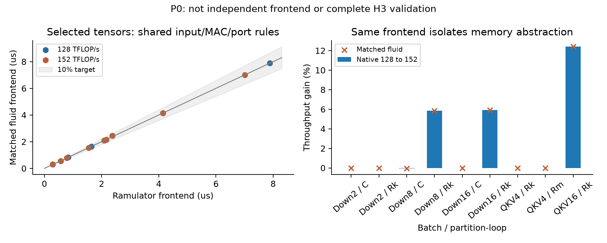
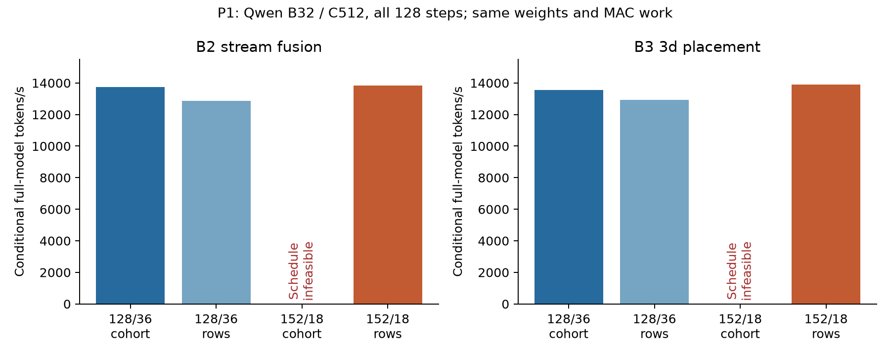
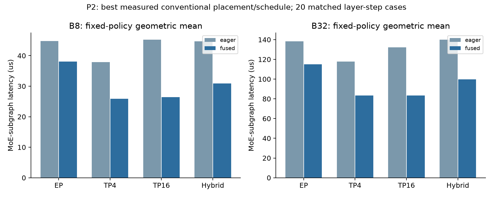
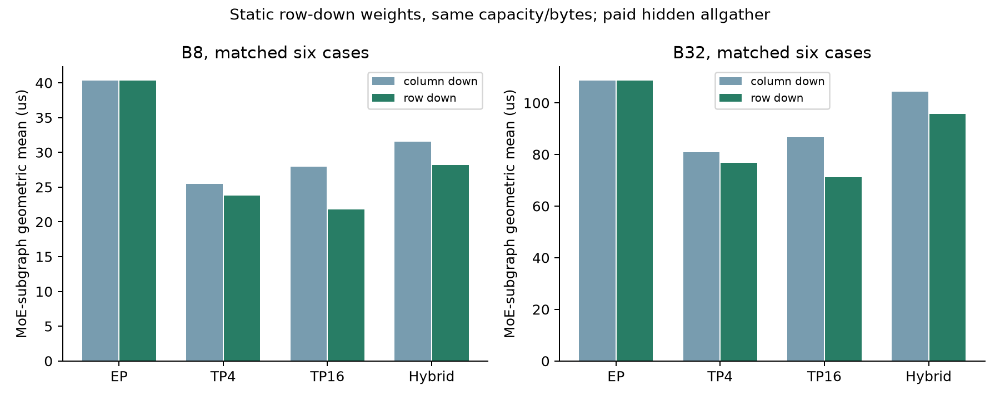
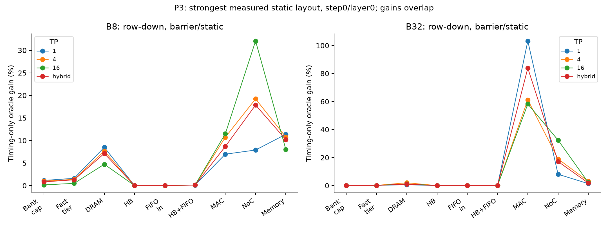
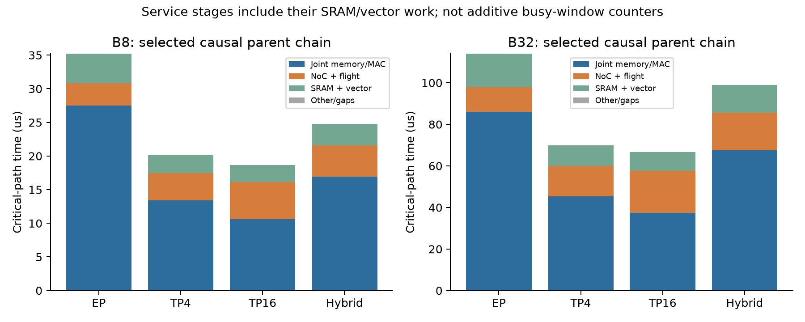
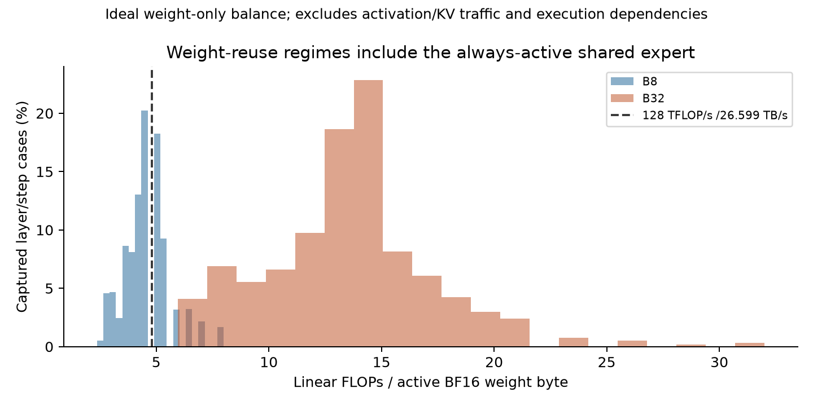
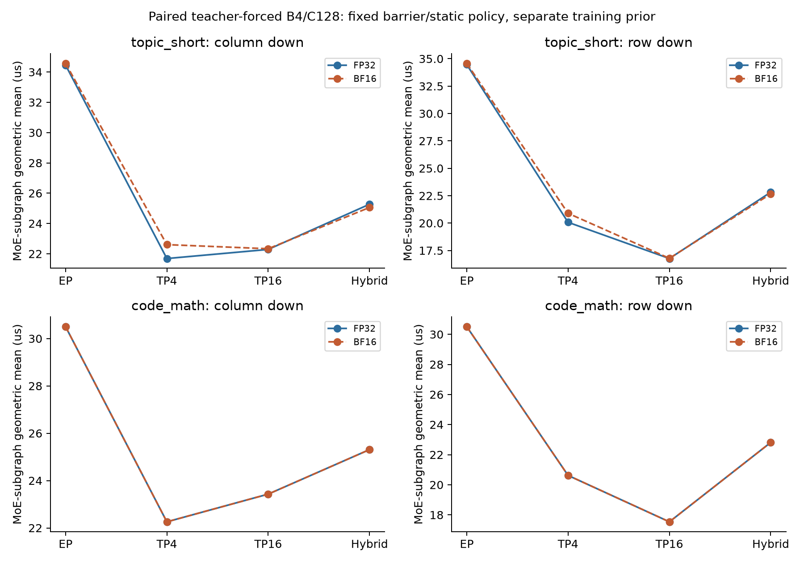

# P0–P3：真实路由与强传统执行基线的架构判决

本轮已完成原生/Fluid资格对照、全部128步workspace修复、EP/TP/Hybrid与付费融合、冻结row-down布局、两组paired routing控制，以及强固定策略下的资源反事实。
**主要判决：在当前条件性模型中，普通软件执行恢复了大量原先看似硬件受限的损失；强基线之后的选定MoE子图更敏感于结果通信和MAC，而不是DRAM/HB。尚未证明一种传统软件无法等价实现的新硬件机制。Research Go保持，新的Hardware Go未建立。**

唯一研究主线为thermal_exploartion的hybrid-bonded DRAM-on-logic：121mm²、32GiB/256 banks/8 tiers、16 logic tiles、128TFLOP/s、36MiB SRAM、32TB/s HB、4×4 mesh每方向32GB/s。计算均在logic，不涉及PIM或Power Delivery。其他项目的cold FFN和Gateway性能没有参与此结论。

## 完成范围与真实性

| 项目 | 完成记录 | 证据边界 |
|---|---:|---|
| P0 Native/Fluid | 36 tensor点；18绝对延迟对照；9相对profile对照 | 相同flit/compute/port前端，隔离Memory abstraction |
| P1 workspace | 8点；6点完成24层×128步，2个预期cohort失败 | 完整条件性Decode模型，真实路由驱动 |
| P2 EP/TP/Hybrid | 960 eager +960 fused；144 row-down补充 | 每固定策略20个主case；row-down仅匹配6个case |
| P3资源隔离 | 400原始点，含基线重放；160点针对最强barrier/static | step0/layer0、B8/B32、四种partition、两种down布局 |
| Prompt/dtype执行 | 288 eager +576 fused | B4/C128，两个prompt族，paired FP32/BF16输入 |

合计3,336个已完成P1–P3/控制记录（3,334成功、2个预期失败），146个进程全部exit0；P0另外36点。
1,289个退役模型/调度点另外保留，不计入有效性能矩阵。122项核心回归通过；新增强策略的none重放与P2在延迟、活动量和关键路径上逐项相同。
全部完整记录均核对source pin、routing/prior哈希、case集合、point/summary一致、事件摘要、MAC/DRAM与关键路径闭合。没有用smoke或合成expert选择替代主评估。

主capture来自原始Qwen/Qwen1.5-MoE-A2.7B checkpoint `1a758c50ecb6350748b9ce0a99d2352fd9fc11c9`，FP32、32个受控holdout prompts、C512、128步、24层。四个不同training prompts的256个prefill位置生成静态先验，不使用未来Decode路由选择权重布局。
B8使用同一B32 capture中的前8个请求，不是另行捕获的生产B8 serving trace。
这里的“真实trace”是原模型实际捕获的router ID/概率驱动结构化架构执行；架构执行器没有数值计算完整BF16 LLM，也不是实机Serving计时。

## P0：误差目标通过，但共享前端仍是边界

选定tensor的Native/Fluid最大绝对延迟相对误差为**2.799%**，18/18通过10%目标；9/9相对128/36→152/18预测通过5%目标。
Fluid速率沿用未按目标延迟拟合的26.599TB/s guard。两端共享计算/端口/有限缓冲前端，所以这不独立验证整个执行前端，不认证完整H3，也不为上一轮12.92%/7.06%全模型增益授予新精度资格。旧whole-input/32KiB mismatch数据继续保留。
Native half-CK tick和logic tick均为0.25ns，比例1；旧factor-two校正已经撤回，见[时钟勘误](../../docs/clock-domain-erratum.md)。

## P1：B32失败可由已知软件修复

| Placement |128/36 cohort tokens/s|128/36 rows tokens/s|152/18 cohort|152/18 rows tokens/s|
|---|---:|---:|---|---:|
|B2_stream_fusion|13743.4|12879.6|有限调度失败|13851.6|
|B3_3d_placement|13553.4|12927.6|有限调度失败|13910.5|

64-row bounded accumulation的workspace峰值为288KiB，低于152/18可用438.875KiB。所有成功配置都保留相同MAC、DRAM和HB工作量。
152/18 rows相对同placement的128/36 cohort分别提高0.79%和2.63%；相对128/36 rows约提高7.55%和7.60%。跨两种placement与原最强128/36 cohort比较，最高条件性tokens/s只提高约**1.22%**。这是容量修复和资源权衡证据，没有数倍全模型硬件收益。
152/18的面积仍受既有缩放/periphery假设约束，不是硅片校准，逻辑面积也没有免费兑换成DRAM面积。

## P2：传统fusion和静态layout不能缺席

下表为每种partition在同一20个layer/step cases上的几何平均延迟（μs）。每一列选择一个固定placement/schedule/order；不允许逐点切换oracle。

|Partition|B8 eager|B8 fused|B32 eager|B32 fused|
|---|---:|---:|---:|---:|
|EP|44.815|38.027|138.283|114.874|
|TP4|37.932|25.893|117.773|83.424|
|TP16|45.230|26.416|132.333|83.348|
|Hybrid|44.726|30.934|139.931|99.618|

同policy配对的TP16 fusion子图吞吐提高为B8 **1.712×**、B32 **1.588×**；总link activity分别约减少至原来的1/3.667。
机制是每tile支付完整B×D FP32 token accumulator，本地weighted sum之后每row仅一次普通归约。MAC、权重字节保持相同；这是已有代数线性性和软件fusion，不能包装为新硬件。
`2f63ce6`早期concurrent final reduction占满64KiB输出credits，会阻塞它依赖的local partial，产生B32 barrier死锁。`15ad39e`用普通local drain与逐row admission修复，没有增加buffer/port；旧184个fused/row失败和其余旧记录归入退役调度控制。

Row-down权重在加载前静态按output row分片，容量、tier bytes和MAC均保持相同，hidden allgather被付费。与同policy、同6个cases的column布局比较：

|Partition|B8 column/row μs|B8子图吞吐增益|B32 column/row μs|B32子图吞吐增益|
|---|---:|---:|---:|---:|
|EP|40.296/40.314|-0.05%|108.541/108.607|-0.06%|
|TP4|25.477/23.780|7.14%|80.919/76.878|5.26%|
|TP16|27.958/21.787|28.32%|86.636/71.168|21.73%|
|Hybrid|31.502/28.150|11.91%|104.285/95.675|9.00%|

Row-down的6-case均值不与column的20-case均值直接比较。EP的轻微负收益也保留；收益包含macro-prefetch/tiling与通信变化，不是纯NoC字节归因。

## P3：使用强基线后，存储故事显著收缩

融合后barrier/static是本矩阵更强的固定策略。它与overlap/dynamic同时改变prefetch、顺序和read-port分配；当前保守joint资源预留不能保证名称为overlap的策略更快。
因此主P3补跑barrier/static全部10个干预，并核对none与P2一致。以下是TP16、row-down、step0/layer0；各项是单独的timing-only oracle，不能相加，也不是可制造机器。

|工作量|真实基线 μs|DRAM-only μs|HB+ingress-only μs|MAC-only μs|无限NoC μs|理想Memory μs|
|---|---:|---:|---:|---:|---:|---:|
|B8|18.63175|17.79150|18.60700|16.71200|14.10775|17.24700|
|B32|66.64075|65.85250|66.61150|42.11800|50.30875|65.20900|

B8的DRAM-only加速余量约4.72%，HB+ingress约0.13%，理想Memory约8.03%，无限NoC约32.07%。
B32的DRAM-only约1.20%，HB+ingress约0.04%，理想Memory约2.20%，无限NoC约32.46%，MAC-only约58.22%。以上百分比均为`T_baseline/T_oracle−1`，不是延迟减少比例。
旧overlap/dynamic的同一TP16 row case曾给出理想Memory约41.07%/13.69%的余量；强软件策略将其收缩到8.03%/2.20%。因此不能围绕弱调度下的memory stall直接设计新DRAM/HB结构。
HB-only/ingress-only零增益不证明接口没有成本：两个500B/tick项取max，单独移除一个仍留下另一个。补充联合干预解决了这个归因边界；强策略下其可恢复时间仍很小。Bank-cycle/Tier probes也未给出显著存储组织杠杆。

关键路径图按实际dependency/resource/credit parent chain闭合；joint memory/MAC节点含供数、计算和operand read约束，不是纯MAC stall。
事件只在packet DAG显式保留prefix，公开activity另从完整kernel ledger补齐DRAM/HB和operand SRAM reads，全局及per-tile闭合；原packet-only账目另存。这不升级为原生command fidelity。

## 真实reuse、precision与研究边界

全部128步×24层的capture中，计入always-active shared expert后，B8/B32的weight-only算术强度均值为4.568/13.694 FLOP/B，机器峰值算力/shared service比为4.812 FLOP/B。
公式为`8B/(E_active+4)`，shared width是routed width的4倍。这是理想active-weight线性算术平衡，排除activation/KV/vector流量、padding及依赖，不是实测utilization。

两个paired teacher-forced控制的Top-4集合一致率为92.708%和92.057%，不能声称FP32/BF16 routing相同。
在本轮选定6个case中，topic_short的TP4 barrier/static FP32/BF16延迟几何平均差约4.23%（column）/4.08%（row），最大单case差为28.23%/27.11%；overlap/dynamic的最大单case差为30.53%。
code_math选定子图时序相同，不代表全部layer/step的expert ID相同。该B4/C128小控制不是B8/B32/C512主capture的生产验证。

## 架构判断与复现

本轮不批准新的memory service domains、HB landing、Fetch Controller或collective硬件。剩余NoC/MAC oracle信号足以继续研究计算与结果通信的物理组织，但尚无付费机制、独立前端资格和热/面积成本证明，不能据此宣布四大新架构。
软件baseline仍是保守macro joint kernel、固定hybrid mapping及三种已测策略，不是完整HDA-MoE/FlashMoE优化器的复现，也没有证明全局软件最优。
新增一手新意排查包括MoEA、MONET、DyNAMoE、MoE-Hub、DySHARP、ThAME、SIGMA、EIE；来源与读取深度见[文献边界](../../docs/moe_architecture_reading.md)。尤其[HDA-MoE](https://arxiv.org/abs/2609.08682)已针对hybrid-bonded NMP的hybrid deployment/dynamic scheduling；[DySHARP](https://arxiv.org/html/2605.05607)已讨论weighted epilogue、dynamic reduction与token fusion。通用动态调度或reduce单元不够作为新意。
完整前端独立验证、完整BF16 numerical inference、生产路由/多请求/Prefill覆盖、硅片校准PPA和新执行策略的thermal反馈尚未建立。本轮没有thermal扫描，上一轮19个默认温度点不自动验证这些新方案。
最终证据：[逐点数据](all-points.json)、[固定策略配对](decision-summary.json)、[运行审计](run-manifest.json)、[退役控制](retired-controls.json)、[核心验证](validation.json)、[冻结合同](experiment-contract.json)。
[复现说明](reproduce.md)提供实际capture、clean source worktrees及完整矩阵launcher；[公开Raw Release](https://github.com/HaoningJiang-space/thermal_exploartion/releases/tag/expert-execution-2026-10-11)包含分包原始记录与逐文件SHA256。
P1全部phase events、P2每点kernel/critical records及step0/layer0全DAG、P3全部全DAG均保留。唯一已截断的旧gzip被明确标为retired，不作为完整结果。
其他科学图及PDF：[column probes](physical-isolation.pdf)、[row probes](physical-isolation-row.pdf)、[routing reuse](routing-reuse.pdf)、[reuse crossover](reuse-crossover.pdf)；各PNG均有同名PDF版本。
