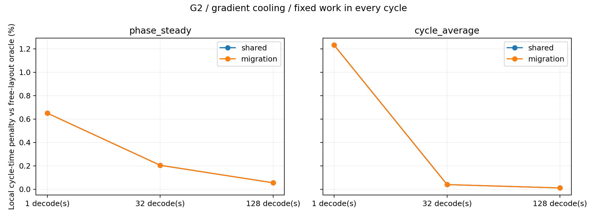
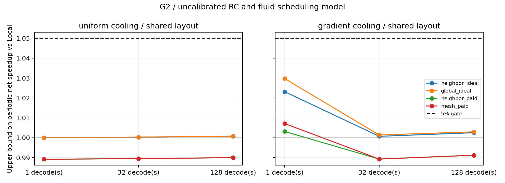

# G2 结论：共享常驻布局仍未让 Fabric 通过门槛

本轮仅检验 Shared Data Placement，保留第一轮模型与负结果，未开发 RTL，也未扩大 Fabric 参数扫描。
在当前未校准的 3D RC 与流式执行模型中，共同权重布局的约束很小。
**理想 Global 的周期净收益上界最高约 2.97%，付费 Mesh 最高约 0.71%，没有通过 5% 门槛。**
按约定，停止当前 Compute–Memory Fabric 分支，不再追加连接重构机制来寻找正结果。
这项停止决策限于当前筛选证据，不等同于证明真实 HB 芯片中 Local 永远最优。

## 实验覆盖

执行代码为 `33a5b231a60f5212bd7746940d62134511e5ef61`，在指定的 72 服务器从已 push 的干净 Git checkout 运行。
HiTS 版本仍为 `c7f94d533cb663c2f098880e5ab333da9d83ff17`，使用 CPU 单位热源求解。

- 一份共同 4096×4096 FP16 权重矩阵，32 MiB；每 Bank Group 同样给定 4 MiB resident capacity，没有阶段专属权重副本。
- 每周期固定完成一次 Batch-32 GEMM，以及 1/32/128 次 Batch-1 GEMV；工作比例不可优化、阶段不可跳过。
- Independent Oracle、Shared Resident Layout、Migration 三个条件分别重新优化 Layout、Mapping 与 DVFS time shares。
- Local、理想 Neighbor/Global、付费 Neighbor/Mesh 与同面积/静态功率预算的 Local matched。
- T0/T1/T2；均匀和原默认冷却梯度；逐阶段稳态与周期平均热约束两个时间尺度对照。

共 **648 个参数化设计点、864 个 LP**。Migration 的第二个 LP 在最优周期时间固定后最小化搬运时间/份额，
避免把无需搬运的等待时间伪装成迁移。没有新增硬件参数搜索。
这些是合成 GEMM/GEMV 阶段，不是完整 Transformer serving trace，也不是经过物理验证的 648 种硬件。

## G2.1/G2.2：共同布局的代价不足以形成新瓶颈

默认冷却梯度下，Local 的 Shared 周期时间相对每阶段免费独立布局 Oracle 的损失：

| 固定工作组合 | 逐阶段稳态 | 周期平均热约束 |
|---|---:|---:|
| Prefill-32 + Decode-1 | +0.650% | +1.231% |
| Prefill-32 + Decode-32 | +0.204% | +0.039% |
| Prefill-32 + Decode-128 | +0.054% | +0.010% |

本轮扫描中，Local 的最大共同布局时间损失为 1.231%。
说明在这组功率系数、冷却和容量预算下，两种阶段需要的静态布局没有形成强冲突。
长 Decode 组合的 Oracle 优势更小；不能把单阶段独立布局的理想化程度直接等同于真实架构损失。

## G2.3：计费迁移没有被选择

Migration 使用所有架构相同的普通 DMA mesh，不与计算免费重叠。
Prefill→Decode 与 Decode→下一周期 Prefill 都按实际搬运字节计入链路带宽、双端 DRAM 读写和能量、请求队列。
未收取固定启动、仲裁和同步成本，因此仍然给迁移较乐观的机会。

**216 个 Migration 条件设计点都选择相同的两阶段布局，搬运字节和迁移时间均为零。**
其最优周期时间与 Shared 条件相同（数值容差内）；免费独立布局的小优势不足以支付有限搬运成本。
这不是迁移约束失效：强制两阶段使用互不重叠的 Bank 集合的回归中，
每次转换搬运完整 32 MiB 权重，来回总计 64 MiB，并分别收取 DRAM 读写和链路成本。
默认方案的“零迁移”是一项应保留的负结果。

## G2.4/G2.5：理想与付费连接都未通过周期门槛

平均热约束下的 LP 不代表真实周期峰值，因此以下采用更谨慎的比较：

1. Candidate 的 Cycle-average LP 时间是温度合规周期的必要下界。
2. Local 在两种热时间尺度条件下分别优化，再检查周期峰值并作必要的 pacing，得到合规调度的时间上界。
3. `Local 合规时间 / Candidate 必要时间下界` 上界约束可能的净周期收益。

该上界依赖当前线性 RC、可分割工作和阶段常功率可实现性假设，不能解释为实测 speedup。
实际周期 Mapping 尚未进行全局瞬态重优化；使用上界是为了避免把冻结调度间的微小差值误报成新拓扑收益。

默认冷却梯度、Shared 布局条件：

| 固定工作组合 | 理想 Global 周期净收益上界 | 付费 Mesh 周期净收益上界 |
|---|---:|---:|
| Prefill-32 + Decode-1 | +2.975% | +0.715% |
| Prefill-32 + Decode-32 | +0.139% | −1.072% |
| Prefill-32 + Decode-128 | +0.297% | −0.878% |

理想 Neighbor 的最大上界约 +2.315%；付费 Neighbor 的最大上界约 +0.316%。
所有 Shared/Migration 的周期净收益上界都低于 5%。T0/T1/T2 的全部 LP interaction 行也没有通过既定净收益/空间交互联合门槛。
付费候选同时保留与 Local matched 的对照；上述净收益统一对无需新增 service Fabric 的原始 Local 比较。

## 时间尺度与 HB 利用率

所假设热容对应的时间常数约从 0.149 ms 到 0.974 s。
最短混合周期约 22 μs，32 次 Decode 组合约 0.2 ms，128 次组合约 0.76 ms。
这些时间与至少部分热模态相近，因此本轮不能只用逐阶段稳态或平均温度代替峰值。
周期检查中，Shared/Migration 的未经 pacing 的 Logic 峰值最高约 85.172°C；
用保持工作/动态能量不变的时间延长修正后，峰值上界符合 85°C。
该 pacing 是一个合规调度构造，不是新的硬件方案。

周期平均热约束可以允许短 Decode 阶段 burst，因此部分单阶段 LP 的 HB 利用率达到约 95.9%（仍是解析模型结果）。
这不能等同于持续跑满 HB。默认梯度、Shared Local 的周期计算流量平均值约为：

| 组合 | 周期平均 DRAM 带宽 | 16 TB/s 峰值利用率 |
|---|---:|---:|
| Decode-1 | 3.12 TB/s | 19.5% |
| Decode-32 | 5.50 TB/s | 34.3% |
| Decode-128 | 5.69 TB/s | 35.6% |

这些均为未经 pacing 的 LP 周期值；pacing 后略低。没有证据表明本轮找到了 HB 特有的持续资源瓶颈。
本轮未扫描 HB 带宽或构建 2D 对照，不把一般多阶段问题包装成 3D 特有创新。

## 验证与证据

21 项回归在本地和远端通过，包括单 Kernel Oracle 一致性、固定阶段完成量、共同容量、
Shared/Oracle/Migration 的放松次序、双向正搬运、周期闭合、平均能量平衡及独立 matrix exponential 对照。
完整套件 exit code 为 0，源 checkout 干净。第一次单组 smoke 曾有绘图 case-selection 错误，已在执行提交前修复，旧输出保留在本地 outputs。

HiTS 共 64 次单位热源 solve，最大原方程相对残差约 `7.42e-12`，与 sparse direct 最大差约 `1.28e-11 K/W`。
周期检查最大闭合误差约 `1.81e-14 K`，平均能量平衡误差约 `8.10e-13 K`。
发布周期采样点之间的插值峰值界；最大已记录间隙约 `2.51e-5°C`。
这些数值检查依然不是 HB bond、冷却或功率参数的物理校准。

- [全比较表](report.md)、[LP 结果](results.csv)、[逐阶段工作与常驻布局](phase_metrics.csv)
- [双向迁移表](migration_metrics.csv)、[周期峰值检查](periodic_audits.csv)、[收益上界](periodic_bounds.csv)
- [版本与依赖](provenance.json)、[HiTS 对照](thermal_validation.json)、[周期模态](periodic_validation.json)
- [验证记录](verification.json)、[原始证据哈希](raw_manifest.json)

完整 Mapping、DVFS、power、periodic temperature records 和运行日志保留在服务器和本地 `outputs/g2-remote-evidence/`。
原始证据没有只留下最佳或正收益场景。

## 决策与边界

**结束当前 Compute–Memory Fabric 筛选分支，保留代码、假设及全部负结果，不推进 Fabric RTL。**
共享常驻布局没有产生强结构性损失，即使先给非局部连接乐观上界，也未通过 5% 门槛。
继续添加重构机制或扩大 Fabric 参数范围不符合本轮事先指定的停止规则。

当前仍缺少多 tensor/多 operator 的联合容量约束、真实 Transformer/KV/MoE 依赖、迁移启动与 scratch-buffer 证明、
周期级 NoC/Controller/partial-sum 行为、温度依赖的 leakage/refresh，以及真实 HB 材料/冷却的参数校准。
若未来由独立真实证据证明这些缺项造成更大的布局冲突，可据新证据另立实验；本轮不据此继续寻找正结果。
研究设计和完整模型假设见 [G2 方案](../../docs/g2_design.md)。
