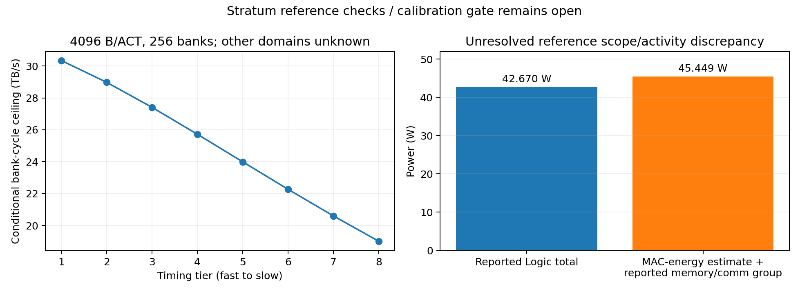
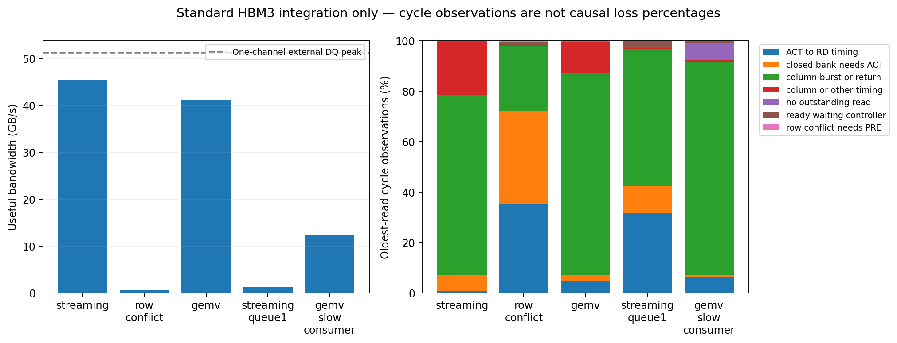
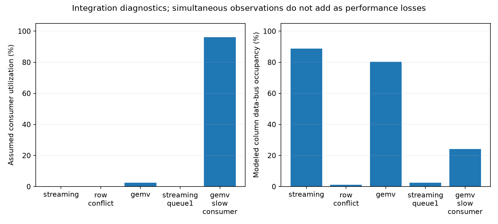

# G3 Reference Machine + Minimal G4: No-Go for architecture claims

**本轮完成参考档案核查和标准 HBM3 命令接口验证；Stratum 的完整校准未通过。**
目前仍不能可靠判断现实 HB 平台首先受 DRAM 内部、Logic 消费还是空间热预算限制。
因此不进入 G5–G7，不重开 Compute–Memory Fabric，也不为缺失项拟合假值。

源代码：G3 核查 [3de8498](https://github.com/HaoningJiang-space/thermal_exploartion/tree/3de8498)；
G4 有限轨迹 [a7d3f94](https://github.com/HaoningJiang-space/thermal_exploartion/tree/a7d3f94)。
均在 Linux 上运行，运行时 source_dirty=false。Ramulator 固定
[c6c7a5d](https://github.com/CMU-SAFARI/ramulator2/tree/c6c7a5de0cef35935d6fad7369e6271406798865)。
完整出处见 [Hardware Contract](../../configs/platforms/stratum_micro2025.json)，具体未校准项见 [g3-audit.json](g3-audit.json)。

## G3：哪些已经匹配，哪些仍未校准

| 核查 | 结果 | 范围 |
|---|---:|---|
| G1/G2 同服务定义退化检查 | 48 对，最大相对误差 7.64×10⁻¹⁴ | 旧筛选机器的入口一致性，含新 cap /旧 serial 模型、请求限制和四种热对照 |
| Bank 数量与容量 | 256 banks，32 GiB | 8 timing tiers 分割行，不倍增 banks；二进制单位由 MAT 拓扑推导 |
| SRAM | 36 MiB | 不重复计入 row-swap RF |
| 最快/最慢 bank-cycle 上界 | 30.34074 /19.01335 TB/s | 与正文 rounded 30.34 /19.01 对齐，不代表实际可达带宽 |
| DRAM aggregate anchor | 104.12688 W 对约 104 W，+0.122% | 0.429 pJ/bit 的总访问能量核查，不是命令级功率校准 |
| Logic 组成核查 | 45.44891 W 对 42.67 W，+6.51% | 超过预设 5%；MAC 活动与能量统计范围未对齐 |
| 活跃 Logic 面积叶项 | 76.55 mm² 对 76.63 mm²，−0.104% | rounded hierarchy 闭合；NoC/controller/vector 独立拆分未知 |
| 内部 HB 连接与 Cooling | 未校准 | pad/rate/area/power/port mapping、几何/热源/冷却边界均缺完整依据 |

[Stratum 的 Table 1/3、Figure 13/15](https://arxiv.org/html/2510.05245v1) 是独立来源。
配置没有混入 SNAKE 工作点、Voxel 组织或 HBM3 的未匹配命令域。
正文内部带宽 30.34 与 Table 3 的 34.34、topology 131.072 与 rounded 128 TFLOP/s、
详细 stack−Logic DRAM 101.86 W 与约 104 W 都保留，未任意合并。

当前并未识别 ACT/PRE/RD/refresh/background、SRAM/NoC/controller/PHY/leakage 的完整费用和活动。
0.429 pJ/bit 的 aggregate anchor 不能再加一份完整 ACT/PRE 能量。
低压 memory peripheral 位于 bonded Logic，aggregate DRAM 功率不能全放进 DRAM 热节点。

## 功率与热约束核查

旧 pilot 的 20×20 mm、h=4000 W/(m²·K)、25→85°C、顶部唯一散热边界给出必要上限 96 W。
16 TB/s ×12 pJ/B 已需 192 W，尚未计入 Logic、ACT/PRE、背景功率。
**旧配置在满带宽前必然节流；这由参数和能量守恒决定，不能当成 HB 的架构发现。**
这是必要条件检查，不是新的 HiTS 仿真或真实封装验证。内部热阻只会收紧该上限。
Stratum cooling 仍未知；没有从旧 pilot 借用热阻生成本轮命令轨迹的功率或温度。

| 对照 | 本轮状态 |
|---|---|
| 标准 HBM3 T0 | 命令链路可执行；没有温度约束 |
| Stratum T0 | 命令域和消费时序未校准，不能做完整性能预测 |
| Stratum T1_layer /T2 | 功率物理分配、HB 与 cooling 未校准，NOT_READY |
| Transient T2 /HiTS 反馈 | G5 deferred，本轮未启动 |

因此功率/空间温度字段显式为 null。旧模型的数值残差不作为这套器件的物理依据。

## 独立命令级验证记录

官方 HBM3 device/controller/refresh/timing/fast tests **128/128 通过**，见 [JUnit](official-tests.xml)。
官方 fast 测试会打印偏差而不强制 5% 断言；本轮另外核查
[实际输出](official-performance.log)：unloaded latency +3.7%、streaming −0.2%、mixed −0.3%。
这组完全匹配上游配置的性能对照通过 5% 门槛。

上游 HBM3 preset 的多个 timing 标为 Guesstimate。所有值按原定义保存，未当作商用器件测量。
构建生成的 13 个 C++ 文件仅有格式/include 排列变化，token 对照和 hashes 见 [provenance](g4-provenance.json)。

另运行 3 个有限地址轨迹和 2 个负向控制。**18704 个请求全部接受、返回、消费一次；
23580 条 issued commands 在独立 device 状态实例重放合法。** 每个 source tile 的 controller 统计也闭合。
独立重放复用相同器件定义，不是第二个独立物理模型。

| 轨迹 | 请求 /读取字节 | 有限轨迹有效带宽 GB/s | ACT | PREpb /PREab | RD | REFab |
|---|---:|---:|---:|---:|---:|---:|
| Streaming | 8192 /262144 | 45.449 | 320 | 192 /2 | 8192 | 2 |
| Row conflict | 256 /8192 | 0.592 | 256 | 255 /0 | 256 | 6 |
| GEMV | 1032 /33024 | 41.087 | 72 | 8 /0 | 1032 | 0 |
| Streaming, inflight=1 | 8192 /262144 | 1.268 | 3433 | 42 /104 | 8192 | 104 |
| GEMV, slow consumer | 1032 /33024 | 12.405 | 72 | 8 /0 | 1032 | 0 |

标准 one-channel HBM3 的 external DQ peak 为 51.2 GB/s；上述数字包含启动、结束和 AllBank refresh。
它们不是内部 HB 带宽，也不是经过热约束的持续性能。
Row conflict 用依赖链强制单 bank 两行切换，不能与不同问题的 Streaming 直接相除作为架构收益。

GEMV 是 128×128 FP16、batch=1：256 B 输入、32768 B 权重、32768 FLOP、256 B 输出留在 Logic。
每个权重块依赖完整输入和同一输出行的前一块；请求记录包含实际地址、bank、source、依赖及消费时间。
独立数值重放覆盖全部矩阵元素一次，与 CPU oracle 最大误差 0。
Ramulator 不模拟数据值；输入广播、SRAM ports 和 MAC array 的详细执行仍未校准。
consumer 的 16 tiles 和速率只是集成控制量，不能据此预测真实 Stratum NPU。

## Bottleneck diagnostics 与解释边界

图中每周期只观察最早接受且未返回的请求。分类互斥，但不等于关键路径的性能损失百分比。
`column burst or return` 表示已发出 column 命令、等待返回，不能把它全部归因于 column 结构瓶颈。
读请求状态、Logic 活动和队列状态可以同时存在，不将它们相加成损失 100%。
open-row 时间另有记录，但不是 Bank busy/idle；尚未实现的 busy、物理 HB utilization 和 thermal stalls 明确留空。

queue 从 64 减至 1 保持同一 Streaming 地址和字节，有效带宽下降，检查请求并行性的作用。
GEMV consumer 从 32 降至 0.25 FLOP/tile/tick 保持全部工作和地址，完成时间变长，
假设 consumer 利用率达约 96.2%，column occupancy 约 24.2%。这支持消费接口的反压生效。
这些控制验证供应链的因果方向；不证明 HB 引出了新的 DRAM 硬件瓶颈。

## Go / No-Go 与交付

**Go：** 共用 Memory Service Model、来源隔离的 Hardware Contract、标准 HBM3 命令/事务接口。

**No-Go：** 正式 Stratum 持续性能比较、G5 热闭环、G6 新架构机会筛选、G7/RTL。
停止原因是缺失可识别的功率/命令域/HB/cooling 参数，不是已证明现实平台没有架构机会。
本轮未运行 SALP/FGDRAM 的架构收益对照，无法报告它们能恢复多少；G6 前不得声称排除了已有技术。
FGDRAM 与 DreamRAM 已加入强基线清单；不再扩大未校准的 Memory Audit 参数扫描。

- [逐案例指标](g4-metrics.csv)、[互斥观察记录](g4-cycle-observations.csv)、[全部汇总](g4-summary.json)。
- [压缩原始轨迹](g4-raw-traces.tar.gz)：全部 5 例的 config、地址请求、issued commands、接受/完成/消费事件、每周期队列与状态、controller stats。
- [核查记录](verification.json)、[测试日志](final-tests.log)、[失败尝试](failed-attempts.md)、[文件 hashes](artifact-sha256.json)。
- [复现流程和条件性路线](../../docs/grounded_validation.md)。
