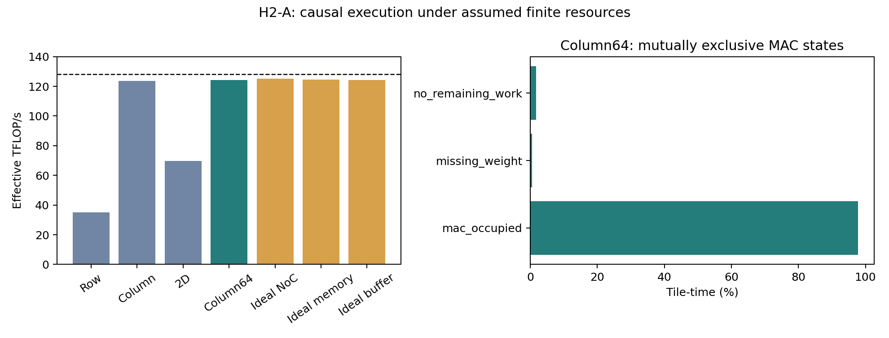

# H2-A：完整有限资源执行，经典Column数据流接近计算上限

H1的43.69/128TFLOP/s是容量上界。本轮对相同1024×16384 FP16权重、batch32、16Tiles、128TFLOP/s、
36MiB私有SRAM、32TB/s HB和32GB/s每方向4×4 Mesh，执行真实请求→Ramulator命令→返回→HB/SRAM→MAC→Tile归约。
所有计算在Logic，最终FP16输出归属一致；不执行浮点矩阵值，不声称器件校准。

|优化已有执行方式|完成时间 μs|有效 TFLOP/s|
|---|---:|---:|
|Row：blocked / k-major|30.48550|35.22139|
|Column：blocked / m-major / 256B归约|8.68425|123.64244|
|2D：blocked / k-major|15.39175|69.76087|
|Column：已有64B流式归约|**8.64325**|**124.22894**|

Column64达到128TFLOP/s峰值的97.05%。MAC block按整数tick执行，`mac_occupied`为97.84%tile-time；
两者不同是block舍入，不是多执行FLOP。共完成2³⁰ FLOP、32768个1024B权重事务、32MiB有效权重，
以及491520次FP32归约加法和32768次最终cast。双方输入均为相同canonical shards，未免费复制完整输入。

## 与最快基线完全匹配的隔离对照

|仅解除一项限制，仍为64B归约|时间 μs|TFLOP/s|相对提升|
|---|---:|---:|---:|
|真实有限资源|8.64325|124.22894|—|
|Ideal NoC，保留SRAM/Vector/工作量|8.57800|125.17391|0.7607%|
|Ideal Memory，保留HB/SRAM交付|8.61525|124.63269|0.3250%|
|Ideal Buffer，保留端口与NoC|8.64325|124.22894|0.0000%|

这些是相同固定执行策略的反事实，不是对所有调度的全局最优证明，增益不可相加。
与H1相同，Row最拥塞方向链路传送786432B，容量下界24.576μs；本轮完成时间30.4855μs，未违反43.69TFLOP/s上界。
Column的最拥塞链路98304B，容量时间3.072μs，计算成为主要约束。

## 因果窗口与实际等待

Row的MAC互斥状态中，等待输入占1400148/1951072 =71.76%tile-time；等待权重远小于此。
NoC覆盖区间24.585μs；MAC覆盖区间30.4315μs，实际总完成30.4855μs。
Column64的MAC覆盖8.462μs，归约覆盖8.33175μs，NoC覆盖8.3335μs，但总时间8.64325μs。
**窗口大量重叠，不能将它们相加。**DRAM返回跨度也包含请求供应被MAC/缓存反压限制的空档，不能直接当作DRAM忙碌时间。

## 物理访问与软件对照

所有分片均有优化blocked与bank-swizzled row-major布局。Column row-major为122.71TFLOP/s，padded-row为122.37TFLOP/s；
后者半行利用与额外驻留容量均收费，不能假定列切分必然损失一半系统性能。
8KiB权重buffer负向控制为61.40TFLOP/s，说明预取存储确实生效；这是人为减小缓冲，不是强传统基线。
全部22个预设点保留：21个完整执行；关闭归约流水的`column_barrier`在2,000,000 tick限额内未完成。
该项保留全部部分事件和失败信息，不分配有限延迟，不据此证明所有屏障策略必然死锁。

## 独立核查与原始证据

每个完整点重放所有DRAM状态/时序约束与Transaction ID；检查事务、字节、FLOP、部分和依赖、MAC/Vector互斥、
SRAM逐tick端口与总容量、NoC每方向序列化，以及每次注入、接收与转发。
另外用独立脚本重建FIFO顺序、同tick路由阶段和已排队/在途credit；详见[fifo-audit.json](fifo-audit.json)。
Ideal transport跳过物理FIFO，明确标记NOT_APPLICABLE，不算作物理链路验证通过。

执行source为`a75e223`与`aa62102`，导出`bce8c46`，独立FIFO审计`770b8c1`。
Ramulator固定`c6c7a5de0cef35935d6fad7369e6271406798865`；内部服务时序是公开假设代理，不是标准HBM3外部DQ或精确Stratum。

[完整原始事件与命令](https://github.com/HaoningJiang-space/thermal_exploartion/releases/download/h2-execution-2026-10-10/h2-raw.tar)
207687680B，SHA256 `aa5032047094697d2ef9929d07d59d98740d95ac46ebb4c5d0749c5073dc51a3`。
发布前扫描并逐entry核查1810688436B原始内容；[manifest](raw-manifest.json)给出每个文件的大小与摘要。
全部成功/失败点见[all-points.json](all-points.json)和[all-points.csv](all-points.csv)。

## 决策

**H2-A Research Go：执行方法可进入Decode链分析。新增孤立GEMM硬件：No-Go。**
经典Column/packing/流式归约已恢复绝大多数容量优势；三个固定策略隔离增益均小于1%。
更严格地，保持128TFLOP/s计算预算时，任何额外改善都不可能超过`128/124.22894−1 ≈3.04%`，不需要假定这三个probe为全局Oracle。
不据此提出新NoC、Fabric或输入消费单元。
H3转向有限工作集、真实声明的路由偏斜与跨算子依赖，并保留Megatron、split-KV与EP/TP强基线。
