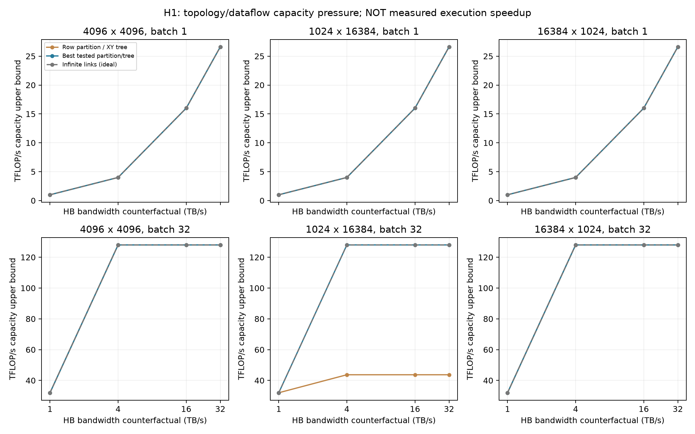
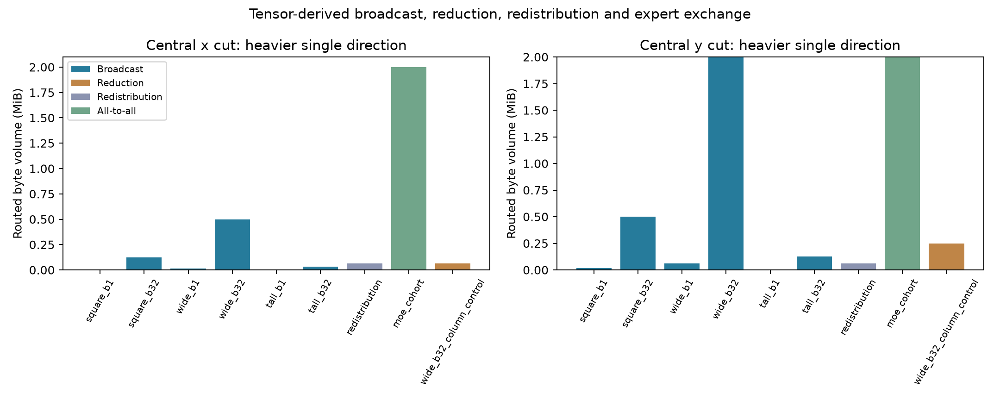

# H1：横向容量有信号，首先由已知数据切分解释

**Research Signal成立于固定行切分的宽矩阵；Hardware Go尚未评估。**
本轮得到的是张量交通和条件性容量上界，没有运行带NoC排队的算子执行，也没有测量真实加速比。
固定行切分的广播可先于HB供数成为必要容量限制；已有列切分可大幅减少该需求。
这支持先改变横向传送的数据，尚不支持设计新的横向网络或协作单元。

## 固定资源与证据边界

121mm²、16Tiles、128TFLOP/s、32GiB、36MiB SRAM、K32。
Mesh每方向每邻接链路32GB/s，有限对照16/64GB/s；归约在Tile上执行，额外加法按64Gadd/s/Tile收费。
MAC FLOP、输入与最终输出归属、权重总量和链路资源在矩阵切分对照中一致。
输入FP16、部分和FP32，不能为了让归约更便宜将部分和偷偷按FP16传送。

HB扫描1/4/16/32TB/s是带宽隔离反事实。DRAM固定cap为D1 baseline观测的26.599TB/s，
冻结成cap是额外架构假设；该观测不是所有Controller/轨迹的数学最大服务率。
算子权重≤1GiB且假设full-row、fast-tier驻留，不能推广到全32GiB多Tier。
NoC area3mm²、1pJ/B-hop仅为明确的工程假设；没有独立电路综合、温度或功率闭环。
所有ideal timing controls保留原交通和能量代理，并保留向量归约工作，不因去掉延迟就删除能量。

这里`max(weight_bytes/min(HB,cap), FLOP/peak, max_tile_adds/vector_peak, max_link_bytes/link_rate)`
是冻结容量假设内的时间必要下界。其倒数是乐观吞吐上界，**不是可行调度**。
缺少有限SRAM/收发反压、Router仲裁、传播延迟和依赖关键路径，所以也不是精确HB NPU性能预测。

## 清楚的宽矩阵信号

三种FP16矩阵的权重均为32MiB，batch1/32。输入与最终输出分别均匀分片驻留16Tiles。
默认HB32TB/s、link32GB/s的Batch-32结果：

| 形状 | Row/XY容量上界 | 最佳已测试切分容量上界 | Row/XY主导必要条件 |
|---|---:|---:|---|
| 4096×4096 | 128.00 TFLOP/s | 128.00 TFLOP/s | Compute |
| 1024×16384 | 43.69 TFLOP/s | 128.00 TFLOP/s | Broadcast的单链路容量 |
| 16384×1024 | 128.00 TFLOP/s | 128.00 TFLOP/s | Compute |

宽矩阵Row/XY广播共15MiB byte-hop，热点链路需要传送768KiB，时间必要下界24.576μs。
中央y割集单方向2MiB/128GB/s给出16.384μs，独立于热点单链路条件；两方向不相加混用。
其计算必要下界8.389μs、模型DRAM/HB条件1.261μs。HB升到约1.365TB/s后，固定Row/XY组织就先受横向容量限制。
默认扫描HB1时上界32TFLOP/s，HB4/16/32都停在43.69TFLOP/s。

列切分保留同一MAC工作和同一最终输出布局，每Tile产生128KiB FP32部分输出并参与归约，替代1MiB全输入广播。
总byte-hop降到1.875MiB，减少87.5%；热点链路条件为3.072μs，向量加法条件0.8μs。
仍需要向量加法与归约交付，并没有免费合并部分和。
若要达到计算容量，Row/XY热点链路需至少93.75GB/s；该列切分只需11.719GB/s。
列切分的向量资源临界值约6.104Gadd/s/Tile；64Gadd/s是本轮假设，不是实测能力。

这些上界之间的差距不能计算成实际speedup；普通Row/XY也不是“充分优化传统NPU”的最终基线。
列/二维切分、树方向选择都是已有数据流手段，本轮未发现需要新硬件才能改变的流量来源。

三个预设link容量16/32/64GB/s下，宽矩阵固定Row/XY上界分别21.85/43.69/87.38TFLOP/s。
已测试列切分的容量上界均回到128TFLOP/s。
Square在16GB/s下也出现链路容量压力，已测试二维切分可使其容量上界回到计算条件。
这说明映射在有限容量内有作用；尚未证明128TFLOP/s可在有限缓冲和依赖执行中实现。

## 四类交通与三个对照

Broadcast/Reduction逐片段生成multicast/reverse tree，树边一次收费，不使用逐目标unicast虚增广播量。
所有矩阵切分额外加法满足`(column_parts-1)×m×batch`；完整权重和MAC FLOP保持。

Redistribution为4096×32 FP16 tensor的row-block→column-block置换。
未对齐布局时链路时间条件0.512μs，单独去掉Broadcast/Reduction不会改变它。
若允许初始DRAM数据已按消费者布局驻留，则没有该转换交通，最终输出归属相同。
**这是初始放置松弛**：如果输入必须由固定前序布局产生，不能免费使用这项对照，必须验证完整生产者—消费者链。

MoE固定256tokens、4096维、top2、16experts，两次4096×4096线性投影。
512个expert assignments全部保留，dispatch和combine各4MiB，平均路由产生20MiB byte-hop。
默认All-to-all链路时间条件16.384μs，计算条件268.435μs，因此该均衡cohort未出现横向容量主导。
它不覆盖实际router偏斜、依赖或SwiGLU；不能由此断言真实MoE通信不重要。

Infinite NoC与Zero Broadcast/Reduction只去掉指定交通的链路时间，向量运算保留。
在纯矩阵案例中两者上界相同是预期现象，因为这里只产生Broadcast/Reduction。
在Redistribution案例中，第二个松弛不改变条件；这验证了交通分类没有偷删其它流量。
MoE All-to-all同样保留，当前计算容量足以使这项通信条件不主导。

第三个对照保存五种矩阵切分、两种物理排列、XY/YX树，以及静态MoE expert循环placement。
这是**有限已知设计集合**的最佳容量上界，不是任意数据归属/计算划分的严格全局Oracle。
等容量时优先较少byte-hop、再较少向量加法，不把任意首个设计当作唯一最优。

## 扩展关系与下一步

[scaling-example.json](scaling-example.json)核对假设注入密度和单方向cut：
8×8、64B/cycle/Tile与32B/cycle/link给出4096B/cycle垂直注入和256B/cycle单方向cut。
若10%在**该方向**跨cut，需求409.6B/cycle、压力1.6。
这是固定密度的拓扑例子，不是HB实际供数预测；全双工反向流量不能套用同一单方向容量。
没有扩放chip-scale材料/冷却参数来声称已验证wafer-scale。

**继续横向执行研究，但本轮不启动新NoC/RTL，也不重新开启Fabric、Peripheral或Row-cycle分支。**
下一项有价值的证据是：在包含已知行/列/二维切分、层次化collective和跨算子布局对齐的基线后，
带有限SRAM、NoC收发反压及真实任务依赖的执行仍损失多少。
Attention必须纳入已有split-KV/流式归约，MoE必须保留路由和全部专家工作；不能只统计一侧通信。
若仅单算子切分已解决容量信号，应记录已知机制有效，不以增加横向带宽为默认答案。
Thermal是后续功耗/可行性维度，本轮不要求热反转，也未开始G5闭环。

依据：[WaferLLM](https://www.usenix.org/conference/osdi25/presentation/he)、
[Eyeriss v2](https://arxiv.org/abs/1807.07928)、[Voxel](https://arxiv.org/html/2604.26821v2)。
上述工作是必须纳入的机制与完整系统对照；没有据本次容量模型宣称击败它们。

## 可复核证据

[全部点](all-points.csv)、[完整逐类割集/能量账目](all-points.json)、[所有切分](all-options.json)、
[全部routed flows](routed-flows.csv)、[配置与假设](profile.json)、[Gate](gate.json)、[版本](provenance.json)。
[容量切换临界值](bottleneck-switches.json)单独记录；GEMV的链路等速HB阈值高于冻结DRAM cap，
Square/Tall GEMM和本例MoE先被计算条件限制，只有宽矩阵广播与未对齐布局转换在默认模型出现横向容量主导。
routed flows是tensor片段/树边交通，不是带实际发出/完成时间的命令轨迹。
源码`02affcc`清洁工作树运行；复用D1已归档命令观测，没有新的Ramulator/HiTS运行。
74项全仓库回归通过；最后输出布局/切分修正后5项H1负向与守恒检查通过。
这些验证支持交通/数学实现，不升级为器件或完整执行验证。
