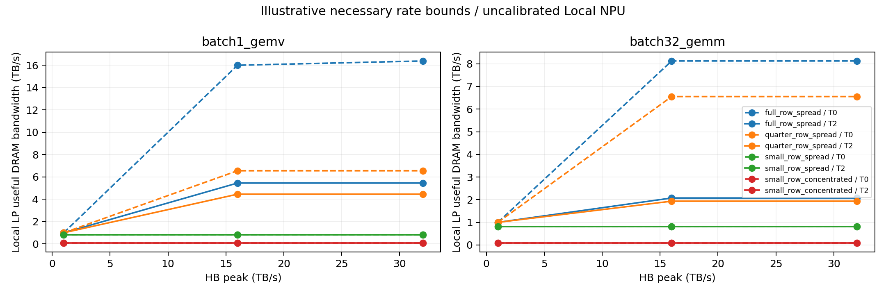

# HB–DRAM 小型审计：目前仍不能确立新存储架构动机

**充分行复用和 Bank spreading 的示例中，持续供数主要受热预算限制；小粒度和 Bank 集中的示例中，内部速率限制变得显著。**
这些是显式假设下的必要上限筛选，不能证明真实 HB 器件存在无法由已有技术解决的新瓶颈。
Compute–Memory Fabric 正式关闭，Mapping 保留为基线；HB-native Memory Organization 仍处于文献与瓶颈分析阶段。

执行源 `effa961270b7aebd8832b21fcda2bf4dd1aed3bc`，原 Linux 干净 checkout，HiTS 不变。
固定传统 Local NPU 的 Compute/SRAM/queue/Bank 资源，HB 仅取 1/16/32 TB/s，比较两种固定 Kernel、四种流量、
常规 Bank 串行与已有 Subarray-overlap 的理想上界，以及四套热控制。共 192 个设计点、384 个 LP。
不提出 Fabric 或新 DRAM 组织。

## 16 TB/s 下的条件结果

| 流量 | 内部必要带宽上限 | GEMV T0→T2 实际模型带宽 | GEMM T0→T2 实际模型带宽 |
|---|---:|---:|---:|
| 每次 ACT 用满 8KiB，32 Banks/Group 活跃 | 16.384 TB/s，shared column | 16.000→5.452 TB/s | 8.125→2.075 TB/s |
| 每次 ACT 用 2KiB，32 Banks/Group 活跃 | 6.554 TB/s，tFAW | 6.554→4.455 TB/s | 6.554→1.934 TB/s |
| 每次 ACT 用 256B，32 Banks/Group 活跃 | 0.819 TB/s，tFAW | 0.819→0.819 TB/s | 0.819→0.819 TB/s |
| 每次 ACT 用 256B，1 Bank/Group 活跃 | 0.091 TB/s，Bank ACT/PRE | 0.091→0.091 TB/s | 0.091→0.091 TB/s |

所有数字均为未校准模型；内部上限是独立速率约束的最小值，不保证存在达到该带宽的命令调度。
GEMM 的 Logic 消费上限约 8.125 TB/s，已经低于 16 TB/s HB；满行场景不能把闲置 HB 通道自动归因于 DRAM 内部。
满行 GEMV 的 T2 热损失相对 T0 约 65.9%，GEMM 约 74.5%。仅移除内部时序上限而保留访问能量，两者 T2 收益均为零。
这支持当前参数中热预算的重要性，不能外推到真实 HB。

## 已有机制与热功耗拆分

Small-row concentrated 的 Bank ACT/PRE 上限可由理想 8-way subarray overlap 从 0.091 提高到 0.728 TB/s，
但不会变成无限带宽；spread 后的 0.819 TB/s tFAW 上限也不随 subarrays 数增加。
后者依赖假设的 ACT-domain 范围，必须用实际 HB 供电/外围组织核对。
改善每次 ACT 的有效字节和 Bank spreading 属于已有 Row locality、Mapping、Tracker 与 SALP 的范围，不能据此申报创新。
SALP 的 MASA 仍保留 tRRD/tFAW，见 [原文 §5.3](https://istc-cc.cmu.edu/publications/papers/2012/SALP-isca12.pdf)。

GEMV T2 的动态 DRAM 功率示例：

| 流量 | ACT | PRE | Array byte cost | Peripheral byte cost |
|---|---:|---:|---:|---:|
| 满行 spread | 3.99 W | 1.33 W | 21.81 W | 43.62 W |
| 256B spread | 19.20 W | 6.40 W | 3.28 W | 6.55 W |

静态 DRAM 另计 4.8W。这里只把原 8nJ 和 12pJ/byte 分为 6+2nJ 与 4+8pJ/byte，
用于检查记账和无效 ACT 对单位字节能量的影响；**不是测得的外围功耗，也没有建模外围电路的真实热点**。

## 可保留的结论与下一层缺项

[Loh 2008](https://www.cs.cmu.edu/~18742/papers/Loh2008.pdf) 已探索高密度 3D 互连下的内存组织，并检查 L2 miss handling；
[SALP 2012](https://istc-cc.cmu.edu/publications/papers/2012/SALP-isca12.pdf) 已放开部分 Bank 内 Subarray 串行化。
[Stratum](https://arxiv.org/html/2510.05245)、[Voxel](https://arxiv.org/html/2604.26821v2)、
[DeepStack](https://arxiv.org/html/2604.04750) 又分别覆盖层间 activation 差异、row 请求协调和 transaction/bank 连接语义。
因此，目前没有确立普通优化和已有 DRAM 技术之后仍存在的 HB 特有结构性损失。

本审计没有真实 HB timing/power specification、command trace、refresh、写回 turnaround、依赖关键路径或温度相关 leakage。
特别是 tRCD 仅记录，未生成其命令级时序；ACT/column-domain 是假设的共享范围；最小速率上限并非可执行调度。
下一步需要先明确目标器件是 planar DRAM die stack 还是 Stratum 类 Mono3D DRAM，
再获取对应 row geometry、ACT/current domain 与外围数据路径参数；用经过验证的命令模型及真实 NPU traces 区分已知调度损失与未解决结构限制。
在这些信息到位之前，不把新增必要速率约束当成新架构发现，也不扩大参数扫描来寻找正结果。

本地与 Linux 均 35 项回归通过；32 次 HiTS 单位热源求解，原方程残差 7.42e-12，direct 响应差 1.28e-11 K/W。
这支持数值与功率记账正确，不验证器件物理。
证据：[配置](config.json)、[全部逐点指标](results.csv)、[内部上限分解](internal_ceilings.json)、
[热求解校核](thermal_validation.json)、[版本](provenance.json)、[测试](regressions.log)、[验证](verification.json)、[原始哈希](raw_manifest.json)。
运行和公式见 [审计设计](../../docs/memory_audit.md)，历史先例核对见 [文献记录](../../docs/literature.md)。
