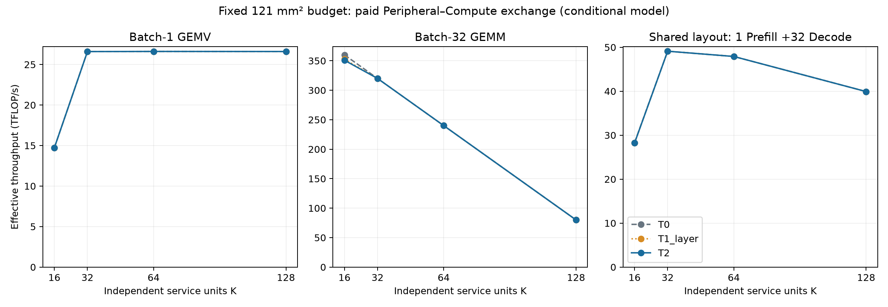
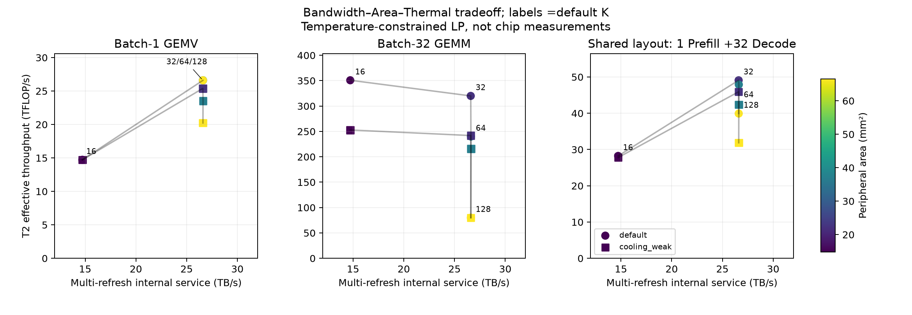

# Memory Service Granularity：面积交换成立，空间热最优性反转未出现

**决策：本轮 Mode B 实验完成；当前证据不支持新的 Uniform Peripheral 架构或 RTL。**
Compute–Memory Fabric 保持关闭。严格 Stratum 器件复现仍 NOT READY，但它没有阻止本轮架构探索。

这里发现了有解释力的资源比例差异：GEMM 偏好更多 Compute，GEMV 需要足够的 Memory Service，
混合负载选择中间组织。**这个差异主要来自已知的并行供数与面积交换，尚未表现为新的空间热机制。**

## 默认结果

固定 121 mm² Logic、256 Banks、32 GiB、36 MiB SRAM、16 本地 Tile 与32 TB/s HB 总预算。
K 表示全芯片独立服务单元数；每 Channel 为1/2/4/8条路径，每单元服务16/8/4/2个 Banks。
主实验把剩余面积用于 Compute/RF blocks；固定128 TFLOP/s 对照另行保存。

| K | Peripheral 面积 mm² | 主实验峰值 TFLOP/s | 多 Refresh 内部服务 TB/s | GEMV T2 TFLOP/s | GEMM T2 TFLOP/s | Mixed T2 TFLOP/s |
|---:|---:|---:|---:|---:|---:|---:|
| 16 | 14.8 | 360 | 14.725 | 14.721 | 350.852 | 28.230 |
| 32 | 22.2 | 320 | 26.599 | 26.593 | 320.000 | 49.105 |
| 64 | 37.0 | 240 | 26.616 | 26.610 | 240.000 | 47.908 |
| 128 | 66.6 | 80 | 26.608 | 26.602 | 80.000 | 39.927 |

360 TFLOP/s **不是 Stratum 的公开峰值**。它来自填充未使用 Logic 面积、按相同 PE-equivalent Compute/RF 面积密度复制计算资源的放松模型。
SRAM容量固定，端口、广播与阵列利用率理想化；这些数值是条件性持续吞吐结果，不是综合或芯片测量。
固定128 TFLOP/s 对照中，GEMM在默认三种可行组织均为128 TFLOP/s，证明主曲线下降主要是计算面积减少。
固定算力的K=128默认超过面积预算，作为拒绝点保留；Shared-area的K=128通过减少计算资源保持可行。

GEMV 的K≥32差异小于0.07%，视为同一供数平台，不把K=64的微小最大值当成独有的最优硬件。
采用预先声明的1%容差，默认 GEMV 可选32/64/128；最小成本代表为32。
GEMM选择16，Mixed选择32。Mixed必须完成一次 Batch-32 Prefill 和32次 Batch-1 Decode，
两个阶段各完成0.001073741824 TFLOP，共用同一32 MiB权重布局，不能删去较难的阶段。



K16→32的服务能力增加约80.64%，但GEMM T2吞吐下降约8.79%。
“更高内部带宽不等于更好的加速器”在此确实成立；不过T0也存在这个现象，因而不能将它包装成空间热带来的新发现。



方块为0.5 K/W的较弱冷却，圆点为默认0.3 K/W；颜色表示Peripheral面积。
相同带宽附近的不同吞吐来自计算面积与付费功率，图中所有T2结果均满足85°C限制。

## Thermal 判别

默认GEMM K16的最优吞吐分别为：T0 **360.000**、T1_layer **352.580**、T2 **350.852** TFLOP/s。
空间模型相对层平均模型降低约0.49%，但三者仍选择K16。
较弱冷却下，GEMV T2在K32约25.39、K64约23.52 TFLOP/s：过量Peripheral开始有可测量的成本，
但T1_layer已经能够表达这个趋势。它主要是总体热预算效应。

20个有限、单项敏感性情景覆盖访问能量、Compute面积密度与能耗、Peripheral面积/功耗、
HB预算、Logic/DRAM热源分配、顶部热阻、HB界面热阻及冷却梯度。
**所有情景中，T1_layer与T2的1%近似最优集合均有交集；未观察到显著的空间热最优组织反转。**
优化后最佳吞吐的T1_layer/T2差异最大约2.10%，出现在较强冷却梯度的GEMM，仍选择K16。
完整比较见 [spatial-interaction.csv](spatial-interaction.csv)，没有只保留最佳点。

默认GEMV K32的可行解Logic/DRAM功率约59.75/52.59 W，最高空间温度约67.44°C；
GEMM K16约139.18/24.84 W，最高温度85°C。LP以吞吐为目标，功率数字是一个最优可行调度，
不代表唯一或最低能耗的调度。默认顶部散热必要上界为200 W，已经消除了旧pilot中192 W DRAM动态功耗对96 W散热能力的明显失配。
热模型仍未校准；能量与空间分配属于明确假设。

## 仍值得保留的行周期信号

只放松row-retention约束，重新生成完整时序，其他ACT域、Column、HB、Refresh、面积与全部能量保持。
多Refresh服务从K32约26.599升至29.661 TB/s；理想化探针的GEMV为29.654 TFLOP/s，
相对最佳已知分区代理约 **+11.44%**；Mixed约 **+10.54%**。
GEMM受计算限制没有相应收益。

**这些收益在T0与T2完全相同。** 它是Bank row-cycle相关的信号，不是已证实的热架构机会。
缩短tRAS是理想放松，不是合法器件实现，也不是经过证明的全部设计空间收益上界。
若继续研究，应先比较保持真实restore timing的SALP/Subarray overlap、FGDRAM等已有机制。
本轮的分区设计是FGDRAM/SALP-inspired代理，尚未完整复现它们或DreamRAM的电路成本；因此没有“击败best-known DRAM”的结论。

## 哪些未知项会改变判断

[Critical-parameter report](critical-parameters.json) 保留器件未知项，而不拟合不存在的数据。
对K32、最快Tier的30.34 TB/s Bank必要上界，tFAW临界值约17.28 ns、tRRD约4.32 ns；
默认15/2.5 ns满足，但假设的tFAW区间12–30 ns跨越临界值。
因此**ACT domain的真实作用域和时序仍可能改变最佳K**，其优先级高于继续增加MAC或HB。
本轮20项控制并未命令级扫描该完整时序区间，不能声称对所有未知参数都稳健。

32 TB/s高于最快Tier满行30.34 TB/s的Bank必要上界；即使增加接口，固定Banks与row-cycle仍限制供数。
每ACT有效数据量若仅256 B，必要Bank上界约1.90 TB/s；该计算只说明必须充分利用行数据，
不是把单次请求大小误当作每次激活的累计有效字节数。本轮每行四个1024 B请求，累计使用完整4 KiB。
32 MiB活跃权重远小于4 GiB最快Tier容量；未声称整个32 GiB工作集都享有快Tier服务能力。

104.12688 W仍只是同一论文公开带宽与能量的乘积；ACT/PRE/RD/background/refresh系数不可独立识别。
Figure15/MAC peak约92.7%的比值不是实测活动率；原文描述full tensor-core utilization，统计关系仍Unknown。
Mode A未就绪、Ayna独立HBM功率Holdout尚未实施，这些不影响以明确假设执行Mode B，但不能升级为器件验证。

## 验证、证据与停止边界

命令实验使用假设的内部宽端口模型，复用固定Ramulator的状态机和Controller；不是标准HBM3外部接口或完整Stratum器件。
15个内部命令case包括4个1 GiB长Streaming、6个短低HB检查、4个4096² GEMV与1个长理想探针。
另有重复地址、Queue64/Queue1关闭Refresh的三个受控检查。
内部case共5570592个请求、8359392条命令，均按独立请求ID核查与同一定义的独立状态实例重放。
重复地址的两个Tile各有独立Read命令及返回。它们是L1软件证据，不是独立物理测量。

长窗口包含6–15个完整Refresh周期；短GEMV的高Burst值与长Streaming的持续值分别报告。
低HB LP采用长内部服务率与HB预算的min，明确假设512 KiB/Tile缓冲平滑Burst，短低HB轨迹只用于接口核查。
HiTS共20×32加默认理想探针32次单位热源求解：672次。最大相对残差约9.98e-12；
Linux与本地61项回归通过。方程正确不等于4×4网格、均匀等效DRAM层与热源位置得到物理验证。
Compute与Peripheral同在Logic节点，不能据此排除未解析的Tile内部热点或其他物理布局。

1077个付费LP点、15个理想探针点和20个面积拒绝记录全部保存。
这些数量表示覆盖与可审计性，不是独立硬件验证数量。
所有此前不完整或错误入口记录列在 [corrections.json](corrections.json)，未用其支持最终结论。

**Go：有限的、明确假设的架构比较方法。No-Go：当前新的Uniform/Asymmetric/Tier-aware Peripheral硬件与RTL。**
不扩大Fabric，不以小差异强行提出新架构。约11%的行周期信号只能先进入已有机制对照；
必须在公平的已知机制之后仍存在HB与空间热相关的剩余损失，才重新讨论新硬件。
这是一项在当前合同与有限情景内的研究决策，不是对全部HB芯片的否定。

## 复现与原始数据

命令/初始分析源 [a3fb304](https://github.com/HaoningJiang-space/thermal_exploartion/tree/a3fb304)，
追加有限控制源 [7f1d14f](https://github.com/HaoningJiang-space/thermal_exploartion/tree/7f1d14f)。
新增控制复用未变更的默认命令，没有重跑或改写既有记录。
[all-design-points.csv](all-design-points.csv)、[summary.json](summary.json)、[provenance.json](provenance.json) 与
[architecture-gate.json](architecture-gate.json) 保存完整数值和决策。

完整TSV、请求事件、命令、周期、配置与哈希放在
[公开原始证据Release](https://github.com/HaoningJiang-space/thermal_exploartion/releases/tag/memory-service-2026-10-10)，
避免将约183 MiB压缩命令数据反复写入Git历史。资产SHA256见 [release-artifact.json](release-artifact.json)。

```bash
python -m thermal_exploration.run_organization --ramulator-root <pinned-ramulator> \
  --thermal-backend scipy --output outputs/new-organization
python -m scripts.export_organization_results --input outputs/new-organization \
  --output outputs/new-public
```

最终代码直接运行包含20情景；分两次生成的本轮结果保留对应源版本。
HiTS复现使用其独立PYTHONPATH和 `--thermal-backend hits`。

依据：[Stratum](https://arxiv.org/html/2510.05245v1)、
[FGDRAM](https://research.nvidia.com/publication/2017-10_fine-grained-dram-energy-efficient-dram-extreme-bandwidth-systems)、
[SALP](https://istc-cc.cmu.edu/publications/papers/2012/SALP-isca12.pdf)、
[DreamRAM](https://arxiv.org/html/2512.12106v1)。
