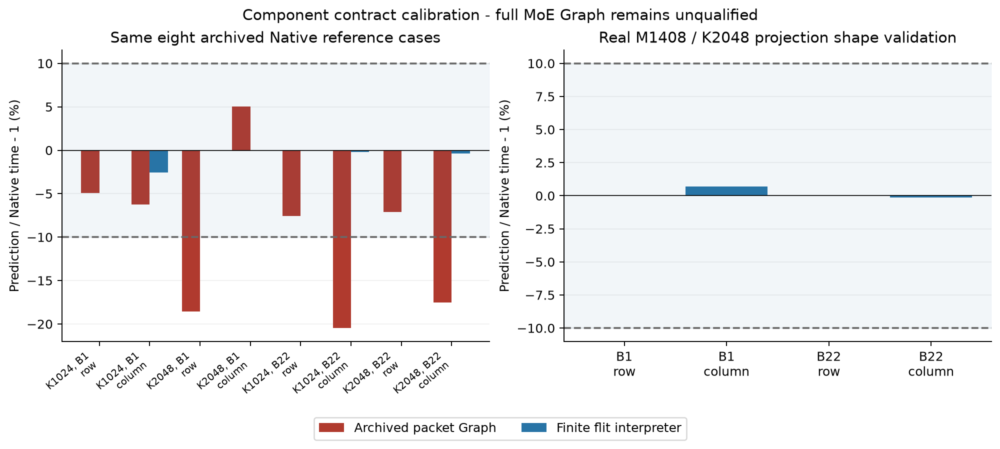

# P4-B 组件校准：同合同误差已收敛，完整 MoE 资格仍未建立

继续采用 `thermal_exploartion` 唯一研究主线。本轮没有重新启动 P4-A，没有新 scheduler/NoC、普通 DSE、P4-C、RTL 或 Thermal 扫描。

**上一轮 `f5f25ca` 的完整 MoE Graph 精度失败记录保持不变。** 本轮补的是一个独立实现的有限资源 tensor frontend，用于解决组件对照的执行合同差异；它没有替换完整 MoE Graph，因此不能把组件资格自动转授给原来约27%/29%的 NoC Oracle。

## 1. 误差来自哪些具体差异

原 Graph tensor 对照使用 packet DAG、eager SRAM 服务窗口和可交错推进的归约 read/vector/write 阶段。冻结 C++ 参考使用32B flits、逐 tick 端口剩余配额、一个活跃 Vector context、明确的 router/VC 仲裁。

此前逐任务记录中，Cold K2048 Row 的一个任务在 Graph 的143 tick开始，在 Native 的390 tick开始，尽管全系统最后输入到达只差11 tick。全局 Byte-hops 或最后到达时刻无法描述每个任务实际获得输入的次序。

Reused K1024 Column 的 Graph 最后 MAC 更晚，但完整输出更早，说明 MAC、端口和结果服务重叠的抽象也不同。不能通过统一延迟倍率修复这两类误差。

这些是**执行合同差异**。单 Vector context 是所选 C++ 参考的控制假设，不是已证明的物理必然性。旧 Graph 的阶段流水化也不能仅因与它不一致就判为非法硬件；合法多个 contexts 的资源与控制账目需要另行明确。

## 2. 实现与资源边界

新增独立 Python cycle interpreter，复现参考已有的：

- 32B flits、两类虚拟网络、每输入 port/VC 8个flits、4 tick链路串行化、8 tick传播。
- 每 Tile 256B/tick read、128B/tick write、16 ops/tick vector、500B/tick FIFO/HB。
- MAC 的 operand/write 需求按剩余周期均摊，与 Vector/NoC 分享同一实际预算；一个 Vector context 执行完整 packet read/add/write。
- 有限 task admission、共享 weight/response/reduce 存储、按 reference count 释放的权重，以及原有 Private SRAM。

Memory 使用已有26.599TB/s guard与26 tick return offset。**预测器没有读取 Native 的到达时间，也没有拟合 latency scale 或搜索参数。** 共享的 tensor contract builder、物理假设和参考仲裁仍是模型边界；这是独立执行实现对照，不是独立 silicon 认证。

详细参考沿用已有 fast-tier internal timing surrogate；本轮没有验证完整 MoE 的全部 DRAM tiers、Refresh 相位或依赖竞争。

完整 MoE 的 `expert_graph()`、macro/fine_fixed/fine_prefetch 及原48个性能点没有切换执行后端。有效冻结源码为 `ffdbe29`，合同见[组件校准合同](../../docs/p4_component_calibration.md)。

## 2.1 同一合同仍可能共同犯错：退役的形状 pilot

首次 `f4fb4b7` pilot 曾取得24/24时间通过和12/12七类trace一致，但完整字节范围审计发现：22-row microtile配合32B结果包，packet可能跨两个MAC输出块；旧C++与Python都只用起始行绑定一个producer。

Native Cold Row有28个packet实际提前消费，Fluid Cold Row有48个，最多提前22 tick（5.5ns）。例如Tile0的packet `[160,192)` 依赖tasks976和992，但Native在938 tick开始，另一个输出块到960 tick才完成。Warm Row虽然实际服务时通常已经等到数据，合同仍缺失显式依赖；整组8点形状pilot及对应Python形状记录退役。对齐的Column和旧M512案例不被断言存在该bug。

**最终延迟、FLOPs、bytes乃至当时核对的七类trace逐行一致，都没有发现这次语义问题。** 因而不能仅凭前端一致认证实验合同。

修复把packet的完整flat FP32范围绑定到所有相交final MAC microtiles；C++、Python和Graph组件分别修正，独立审计从byte几何重建producer集合，并拒绝过早vector消费/注入。没有改变资源、数据量、任务顺序或MAC数量。所有8点Native/Fluid形状参考及24点Python对照重新运行；旧pilot原始字节保持不变，见[退役诊断](packet-retirement.json)与[原资格记录](retired-qualification.json)。

## 3. 已完成实验，如何计数

复用上一轮16个归档 M512 / K1024或2048 / B1或22 / Row或Column / Native或Fluid参考点。
有效重跑新增4个进程、8个 Native/Fluid 点：真实 Qwen routed Gate/Up 的 M1408 / K2048，captured Cold Expert 12 的1个Token及 Reused Expert 10 的22个Tokens，Row/Column。另有退役pilot的4个进程/8点，单独保留，不计入有效资格。
Python独立执行并对照上述24个点；不是24个新 Prompt或24个新原生实验。

1408/16=88 rows采用最大不超过32且整除分片的22-row microtile，以及32B结果包；没有 padding、额外 FLOPs、权重副本或增加资源。
这些采用 H2 standalone canonical-input/canonical-output/BF16-cast 合同，是完整投影**形状**验证；没有执行实际 fused Gate/Up/SiLU、完整 MoE、checkpoint BF16 数值或生产 Serving。

## 4. 资格结果

| 项目 | 结果 |
|---|---|
| 绝对10%时间门 | **24/24通过**；其中 Native-only 12/12 |
| 最大 Native 时间误差 | **2.5404%** |
| Row/Column 相对5%预测门 | **6/6通过** |
| 最大相对预测误差 | **2.6066%** |
| Fluid逐事件一致 | **12/12完整一致** |
| 独立有限资源重放 | **24/24通过** |
| 完整回归 | **140项通过** |

Fluid每个案例核对全部 tasks、input joins、DRAM/HB transactions、vector windows、injections、directed-link flits、sinks 和 per-tick ports，八类 trace均逐行一致；另独立检查完整packet byte范围的producer覆盖与就绪，超出只比较最终 latency 的检查范围。
Native误差反映剩余的 Memory service abstraction 差异；Native/Fluid仍共享 C++ frontend，不能作为独立器件验证。

| Native Row/Column | 参考比值 | Python比值 | 相对误差 |
|---|---:|---:|---:|
| M512 K1024 B1 | 0.752887 | 0.772512 | +2.6066% |
| M512 K1024 B22 | 0.835330 | 0.837193 | +0.2230% |
| M512 K2048 B1 | 1.292632 | 1.292632 | 0% |
| M512 K2048 B22 | 1.630707 | 1.637074 | +0.3904% |
| M1408 K2048 B1 | 1.048972 | 1.041829 | −0.6809% |
| M1408 K2048 B22 | 0.712792 | 0.713767 | +0.1368% |

这些是固定前端/形状下的排序和收益幅度资格，不是完整 MoE TP4/TP16 的排序资格。新形状在运行前冻结，但仍来自同一 captured routing；不称为独立盲测。

## 5. 独立资源审计与负控制

24点重放11,008个 MAC tasks、1,887,808条 port records、430,560次32B link traversal。
每 Tile MAC及Vector context均无重叠；任务只在输入、权重HB返回及 partial dependency 完成后开始。FLOPs、FIFO/DRAM bytes、SRAM read/write、Vector ops与 NoC byte-hops和参考完全一致。

逐条重放 weight/response/reduce reserve/release 与 router credit转移，全部释放。最大 Private SRAM 530,336B，最大单 port/VC router占用8 flits；未超过冻结预算。链路相邻 flit发射间隔至少4 tick，传播8 tick；不能把两个时间项混成一个带宽参数。

负控制拒绝改变物理端口、提前消费、增加 Private storage和超额 byte/router credits。完整记录、误差及 trace comparison见[资格JSON](qualification.json)；新形状来源见[冻结任务记录](shape-manifest.json)。

## 6. 对原研究问题的判断

**G3的所选 tensor组件合同已达到原门槛；完整 MoE的G3/G4仍未建立。** 我们现在能将此前组件20%级误差追溯到不同的网络/端口/控制执行合同，并用匹配合同消除大部分差异。尚不能证明旧 Graph 的6%–8% reservation收益或剩余约29% NoC空间是物理上可恢复的。

下一步必须把同一端口共享、网络仲裁及有限 context合同接入完整 MoE，保持 macro回归、固定路由和 Expert/MAC顺序，再重跑冻结 TP4/TP16与Row/Column案例。只有在这个完整接口资格之后，才检验Shared Expert通信下界及物理所有权。

本轮不提供新的 MoE speedup，不批准新 NoC/MAC，不进入 P4-C；此前失败原样保留。[复现说明](reproduce.md)与[原始记录](https://github.com/HaoningJiang-space/thermal_exploartion/releases/tag/p4-component-calibration-2026-10-11)可分别核对模型边界、源码与全部执行事件。
