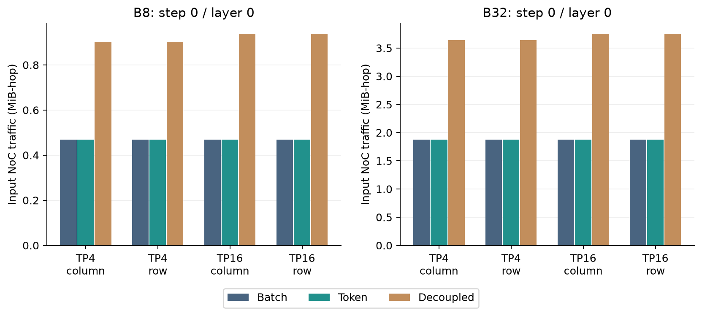
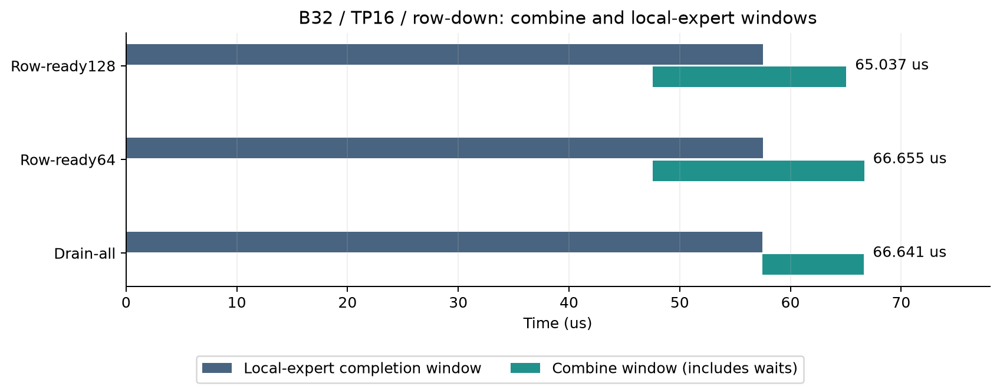
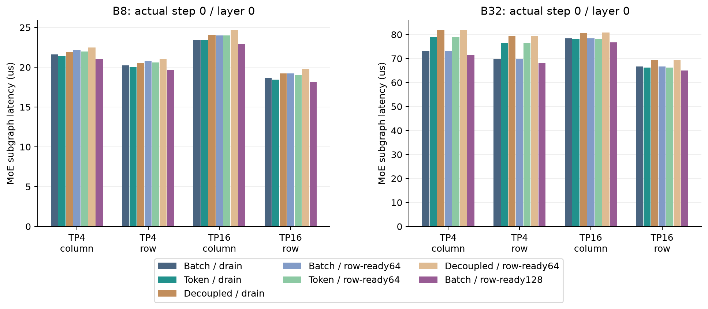
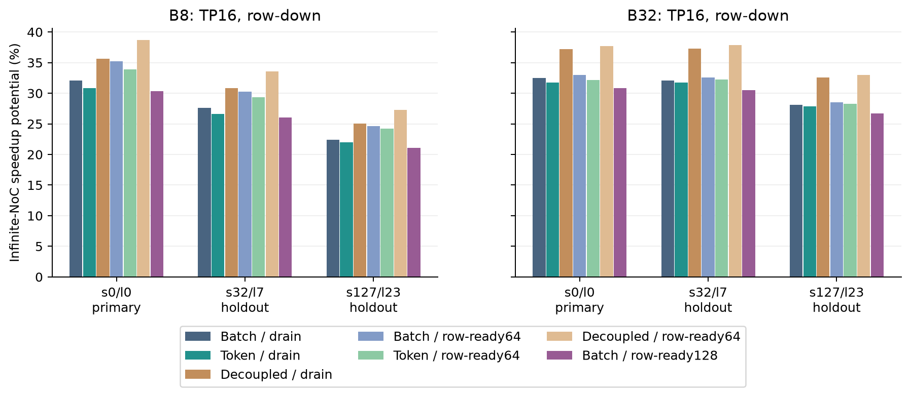

# P4-A：合法通信优化恢复约2%，NoC余量仍不能成为新硬件结论

在原始 Qwen1.5 路由和冻结资源下，最好的已测固定策略为 **Broadcast-all 输入复用 + 128-row Row-ready Reduction**。
相对 `26d1b02`，8个主案例的几何平均加速为 **1.0243×**，16个holdout为 **1.0209×**。
TP16/Row-down主案例的Infinite-NoC诊断收益从B8/B32的32.07%/32.46%降到30.37%/30.84%，收缩有限。
这支持把有界流水化纳入更强的软件基线，仍不能据剩余30%左右的Oracle提出新NoC。
本轮没有改变保守Joint Kernel；P4-B的执行粒度验证尚未完成。

## 实验与来源

只使用 `thermal_exploartion` 的DRAM-on-logic合同；没有混入W2W Cold FFN数据。
执行源码分别冻结为 `2a1188b`（初始288性能点、48数值对照）和 `0f7eaa5`（48个128-row cohort补充点）。
固定128TFLOP/s、36MiB SRAM、32GiB DRAM、原有banks/tiers/HB、16 logic tiles、4×4 mesh和SRAM端口。
所有placement由独立prefill training prior产生，owner和tier bytes在各通信方案间相同。
所有性能点采用真实d2048/h1408/shared5632、原始captured routing；没有smoke或生成路由替代性能实验。

Primary固定s0/l0；holdout固定s32/l7、s127/l23。B8/B32 × TP4/TP16 × column/row down分别配对比较。
使用原强基线的barrier/static资源策略；Destination-only只放松输入就绪依赖，未解耦Joint Kernel。
初始三种dispatch × 两种reduction × baseline/Infinite-NoC共288点。
128-row对照是在观察64-row负结果后独立冻结的48点，不能写成最初预声明矩阵。
最终336个性能点、48个数值对照、64个进程全部完成并归档。

来源及全部执行case见[实验合同](experiment-contract.json)、[run manifest](run-manifest.json)、[审计](audit.json)。
主路由内容SHA256为 `24aba0d1337106563e6b05f4f54ea6d5861838a930a376d99ae5feac9bcdb9e6`；
checkpoint为 `1a758c50ecb6350748b9ce0a99d2352fd9fc11c9`，FP32捕获，B8取原B32捕获的前8个请求。
这不是独立B8生产捕获，也不代表所有prompt或BF16 router分布。

## Destination-only没有可直接删除的Shared输入

固定Shared Gate/Up是intermediate-output sharding，所有16个Tile都有Shared权重分片；每个分片需要完整Token输入。
因此每个Token的必要目的地为routed owners与shared owners的并集，仍为全部16个Tile。
Destination-only逐Token交付、共享同一endpoint输入，改变就绪粒度和packet顺序，**没有减少输入byte-hop**。
Decoupled把Shared全量交付和Routed owner-only交付独立进行，重复通信全部付费；它是取消复用的对照。
本轮没有将Shared改为K-sharding或token-parallel，也没有免费迁移权重或删除其必要转换/归约。
所以这里验证固定Shared权重布局下的通信语义，不能宣布穷尽所有Shared/Routed dataflow。

Destination-only/Drain-all在主案例中的延迟改善范围为 **-9.54%到+0.97%**，holdout为-6.54%到+1.96%。
B8/TP16/Row-down改善0.96%，B32对应案例改善0.57%；B32/TP4/Row-down反而变慢9.54%。
提前开始的Kernel仍会预留SRAM读写、MAC、DRAM和HB资源；packet顺序也改变。
这些结果不能唯一归因为物理网络拥塞或Token就绪，须在P4-B用细粒度事件区分。
独立Decoupled/Drain-all的主案例全部变慢1.37%到13.76%；取消合法输入复用未建立优势。

## Row-ready有效，但有界cohort粒度会改变判断

旧Drain-all等全部本地专家完成后串行接纳128-row reduction。
两个Row-ready方案都等当前行的所有本地contributions，并一次只接纳一个tree/root；允许与后续行计算重叠。
16KiB local-output和48KiB reduction credits来自同一原有64KiB output空间，未增加storage或端口。
64-row cohort有保守完整入边容量界；128-row cohort按256B packet流式推进，用同样有限credits约束注入。
它没有重新引入多个未就绪root的无界并发。

| B32/TP16/Row-down，s0/l0 | 首个Combine启动 | 最后本地专家完成 | 端到端完成 |
|---|---:|---:|---:|
| Drain-all | 57.450μs | 57.450μs | 66.641μs |
| Row-ready64 | 47.550μs | 57.499μs | 66.655μs |
| Row-ready128 | 47.550μs | 57.521μs | **65.037μs** |

64-row在主案例中全部变慢0.02%到3.07%；更多串行cohort不能被忽略。
128-row在全部24个配对工作负载中改善：主案例降低延迟2.05%到2.81%，holdout降低1.61%到2.49%。
因此不能用64-row的负结果否定合法流水化，也不能把128-row的收益解释成新增硬件。
下图是事件的开始/完成窗口，包含等待；不是busy-time之和，也不是可相加的critical-path损失分解。

## 固定策略与NoC诊断

下表是同一策略在8个primary和16个holdout上相对各自旧基线的几何平均加速。
不逐点选择dispatch/reduction；TP和down layout比较保持相同routing case。
128-row补充对照使用全部同样的holdout；补充方案设计时初始验证集已执行，因此它们不是新的盲测集，只验证本轮固定case的迁移，不能代替独立prompt评估。

| 输入 / Reduction | Primary | Holdout |
|---|---:|---:|
| Broadcast-all / Drain-all | 1.0000× | 1.0000× |
| Destination-only / Drain-all | 0.9837× | 0.9966× |
| Decoupled / Drain-all | 0.9513× | 0.9537× |
| Broadcast-all / Row-ready64 | 0.9864× | 0.9888× |
| Destination-only / Row-ready64 | 0.9702× | 0.9854× |
| Decoupled / Row-ready64 | 0.9387× | 0.9434× |
| **Broadcast-all / Row-ready128** | **1.0243×** | **1.0209×** |

TP16/Row-down主案例：

| 方案 | B8延迟 | B32延迟 | B8 NoC诊断收益 | B32 NoC诊断收益 |
|---|---:|---:|---:|---:|
| 旧Broadcast-all/Drain-all | 18.632μs | 66.641μs | 32.07% | 32.46% |
| Destination-only/Drain-all | 18.453μs | 66.263μs | 30.80% | 31.71% |
| Broadcast-all/Row-ready64 | 19.204μs | 66.655μs | 35.19% | 32.95% |
| **Broadcast-all/Row-ready128** | **18.109μs** | **65.037μs** | **30.37%** | **30.84%** |

“NoC诊断收益”定义为 `baseline_time / infinite_noc_time - 1`，是加速比增量，不是延迟可减少的百分比。
两种口径均保存在[配对结果](paired-comparisons.json)。Oracle消除link/flight时间，保留SRAM/vector/MAC、有限buffers和原packet work。
不同调度的Oracle改变执行时序，剩余比例不能当作可由新网络独立回收的损失。
本轮没有重复MAC或DRAM oracle；58% MAC结论仍须接受P4-B的执行粒度审计。

## 数值正确性与有限资源审计

独立dense reference逐Token计算完整矩阵；candidate解释事件图的semantic ledger。
检查Gate/Up分片、Down输出行/K覆盖、实际Token IDs、实际captured routing probability slots和本地融合；每个分片覆盖一次。
性能点另做真实形状的semantic/work检查。
48个小张量对照使用同样真实routing和概率、d256/h32/shared128、确定性生成的输入/权重；小张量只验证语义，未进入性能统计。
FP32/BF16分别检查，FP32 accumulation；BF16测试对输入、权重、概率和gated-state做存储舍入，不重新选择路由。
捕获没有Shared gate activation，数值测试用确定性shared-router权重计算sigmoid，两边使用相同语义。
最大绝对误差 **5.12×10⁻⁹**，最大relative L2 **4.58×10⁻⁷**；容差rtol2×10⁻⁴、atol2×10⁻⁶。
这不是完整checkpoint、完整Transformer或硅片数值验证。

所有336点保存完整nodes/events/leases；独立重放验证依赖、资源无重叠、buffer lifetimes、packet activity、MAC/native bytes和critical-chain账目。
最大独立重放private SRAM占用729,984B/Tile，低于2,359,296B/Tile；最大合并output信用占用51,712B，低于65,536B。
28个与旧归档重叠的case在ticks、activity、MAC/native bytes、critical-chain各stage之和及gap上精确一致。
初始源码全仓127项测试通过；128-row补充变更的14项相关测试通过，均包含真实B32有限信用回归。
失败的mutation测试确认错误routing slot、遗漏shard、超过物理容量的信用分配会被拒绝。

完整记录见[逐点摘要](all-points.json)、[数值记录](numerical.json)、[公开原始归档](https://github.com/HaoningJiang-space/thermal_exploartion/releases/tag/p4-communication-2026-10-11)和[复现步骤](reproduce.md)。

## 研究决定

P4-A在本轮固定权重布局范围内完成；采用Broadcast-all/Row-ready128作为更强的已测软件对照，保留全部负结果。
尚未验证其他Shared weight sharding、更优packet admission、全局软件最优、独立native MoE前端精度或新的thermal/PPA约束。
下一阶段按原顺序做 **P4-B**：真实路由选出的冷expert、权重复用expert、同Tile竞争expert，拆分Memory、Operand、MAC与Result事件，区分物理忙碌与宏调度预留。
完成后才进入P4-C的固定DRAM/logic ownership分析；本轮没有实施P4-B/C，也没有批准新NoC/MAC硬件或RTL。
