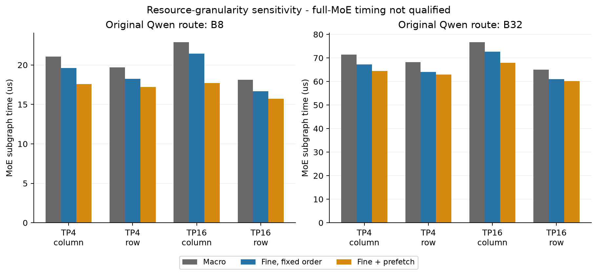
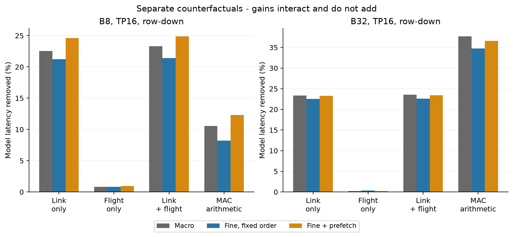
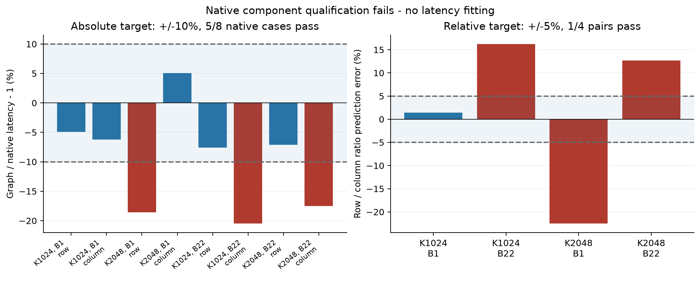

# P4-B：资源预留会影响预测，原生精度门仍未通过

本轮只在 `thermal_exploartion` 主线完成细粒度资源占用与关键路径验证，保留 `df33bb2` 的强软件基线。**实验完成不等于模型资格通过：当前结果不足以批准新 NoC、MAC 或 P4-C 架构设计。**

性能使用原始 Qwen1.5-MoE s0/l0 路由和真实 d=2048、routed h=1408、shared h=5632，B8/B32、TP4/TP16、row/column、冻结 B3 权重布局、Broadcast-all、Row-ready128。完整子图保留所有活跃 Experts 和 Shared。没有 smoke 性能点、合成路由替代或新 scheduler/network。

## 1. 改了什么，隔离了什么

`macro` 保留原 Joint Kernel 的完整行为。`fine_fixed` 保留相同 Expert、MAC 和 Row admission 依赖，仅把局部权重服务拆成 DRAM serialization、return latency、HB、有限 FIFO、MAC microblock、实际 operand/FIFO port windows。DRAM/HB/read/write 不再被整段 Kernel 一起锁住。

`fine_prefetch` 是单独的已知软件对照：在当前路由已知后提前接纳权重请求，MAC/Expert 顺序仍保持。它没有新增 FIFO、返回空间或端口，也不重复计入权重读取。它的收益不能归因于 reservation 本身。

每 Tile 共享原有 8×32KiB weight slots、64×1024B response slots、262144B FIFO、65536B returns、256B/tick SRAM read 和 500B/tick FIFO consume。显式 descriptor credits 额外计入原 private SRAM budget。HB 采用 fractional fluid ticks，避免逐包取整制造额外的供数上限。算术与 operand/FIFO floor 可以 co-issue；实际 operand 服务窗口按 eager policy 占用同一端口。

这仍是 packet/fluid、registered-reuse 模型。Native frontend 使用 32B flits、逐 tick arbitration 和均摊 operand service。**孤立 pipeline 时间一致不能证明两种竞争模型等价。** 详见[冻结合同](../../docs/p4_fine_execution_contract.md)。

## 2. 真实场景与完成范围

从 B32 原路由直接选择：Cold Expert 12 只有 Token 8；Reused Expert 10 和 Contending Expert 34 各有22个 Tokens，TP4 owner 同为 Tiles 8–11。B8 子集没有单 Token Expert，没有为它伪造冷路由。

主实验24个进程、48个性能点，另有48次 FP32/BF16 小张量数值比较。原生组件8个进程、16个 Native/Fluid tensor 点；Graph 对同16点重建相同任务和工作量。M512、K1024/2048、batch1/22 均来自真实维度与路由 Token counts 内的合法子矩阵，**不是完整 MoE 性能或独立生产 Prompt**。

另保留一次零性能点的 launcher import 失败：`3e1557a` 的 launcher 没有将冻结 source 加入 import path；`c95c2d7` 只修复该路径后重启原生组件。失败日志未删除、未计入完成的实验点。主执行 pin 为 `3e1557a`，组件 pin 为 `c95c2d7`。最终完整回归为134项通过。

48点共重放29,223,684个事件，10个P4-A重叠案例精确回归。最大 private SRAM 占用981,344B，低于每Tile的2,359,296B预算；输出分区峰值53,248B，低于共享64KiB。每Node等待分区和 critical chain 均闭合，未归因 critical gap 为零。数值最大绝对误差4.657×10⁻⁹、最大相对L2误差4.425×10⁻⁷；这些只针对缩小后的矩阵规则。

## 3. 宏预留确实影响预测，但未消除网络信号

| TP16 / row-down | Macro | Fine fixed | Fine + prefetch | 单独 reservation 延迟减少 |
|---|---:|---:|---:|---:|
| B8 | 18.109 μs | 16.655 μs | 15.730 μs | 8.03% |
| B32 | 65.037 μs | 60.923 μs | 60.109 μs | 6.33% |

这些是**未完成独立时间资格的模型内敏感性结果**，不能作为可实现硬件加速。Prefetch 另外减少 Fine-fixed 时间约5.55%/1.34%，它与 reservation 的改变分开统计。

八个固定工作负载中，三个粒度都保留：Row 比 Column 快；Row 下 TP16 比 TP4 快；Column 下 TP4 比 TP16 快。这个排序一致只说明本轮粒度对照未翻转上述关系，**不构成 TP4/TP16 的独立原生相对精度认证，也未覆盖 EP/Hybrid 或其他路由**。

## 4. Link 与 Flight 已分别干预

Link-only 移除 serialization，Flight-only 移除 propagation，Infinite NoC 同时移除二者；每个对照保留相同 payload、SRAM/vector 工作量及有限 credits。下表使用 Fine-fixed，报告直接时间差而不是把 stall sums 当作关键路径。

| Fine-fixed TP16/row | Baseline | Link-only | Flight-only | Link+Flight | MAC arithmetic-only |
|---|---:|---:|---:|---:|---:|
| B8 | 16.655 | 13.118 | 16.518 | 13.087 | 15.286 |
| B32 | 60.923 | 47.204 | 60.705 | 47.143 | 39.753 |

单位 μs。MAC-only 仅移除 arithmetic time，保留 operand/FIFO floor 与全部数学工作量。它不是无成本增加 MAC 的硬件结果。

Fine-fixed 联合 NoC 理想吞吐增益为 **27.27% / 29.23%**，对应延迟减少21.42% / 22.62%。Macro 为30.37% / 30.84%。整段预留没有解释全部网络信号。

但 Fine-prefetch 的 NoC 增益又变为33.16% / 30.58%：其他等待缩短后，网络在依赖链中的相对影响可能上升。**各 Oracle 的增益有交互，不能相加，更不能兑换成相同比例的链路资源。** 当前模型里 Link-only 恢复的时间明显多于 Flight-only；原生资格失败使这一归因仍须保持条件性。

## 5. 原生组件资格失败，是本轮最重要的负结果

组件重建逐点核对 MAC FLOPs、DRAM bytes、SRAM read/write、FIFO bytes、Vector ops、NoC byte-hops、任务数量和输出归属，没有用延迟拟合修正误差。

| K / Batch | Native Row/Column 比值 | Graph Row/Column 比值 | 相对预测误差 | 5%门槛 |
|---|---:|---:|---:|---|
| 1024 / 1 | 0.7529 | 0.7635 | +1.40% | 通过 |
| 1024 / 22 | 0.8353 | 0.9709 | +16.23% | 未通过 |
| 2048 / 1 | 1.2926 | 1.0019 | −22.49% | 未通过 |
| 2048 / 22 | 1.6307 | 1.8372 | +12.66% | 未通过 |

绝对10%门槛：8个 Native 配对中5个通过；连同 Fluid 共16个配对中10个通过。最大绝对延迟误差为20.47%。四组 Row/Column 快慢排序均一致，但只有1组收益幅度预测通过5%门槛。不能用排序一致或平均误差替代这些失败。

Native/Fluid 同一详细 frontend 的最大延迟差约2.54%，仍只验证该 Memory abstraction；它没有把 Graph 的20%误差变成合格。

逐任务阶段记录说明误差不是统一倍率。例如：

- Cold K2048 Row：Native 最后 MAC 在610 tick结束，Graph 在496 tick结束；完整输出分别614和500 tick。输入最后交付只差11 tick、HB最后返回差约6 tick，不能把114 tick尾部差异解释成总 DRAM 服务速率差。
- Reused K1024 Column：Graph 最后 MAC 反而更晚（1407.096 vs788 tick），但最终完成更早（4646.096 vs5842 tick）。局部 MAC 时间与网络/结果阶段重叠不同，误差不能靠一个 Kernel latency scale 修复。

这些是匹配 trace 的观测端点，阶段互相重叠，不能相加为独立原因。Packet/flit admission、port demand spread/eager、任务与结果服务竞争仍需同合同校准。详见[全部资格记录](component-qualification.json)与[逐任务阶段对照](component-phases.json)。

## 6. 验收与研究决定

| Gate | 本轮判断 |
|---|---|
| G1 工作量/语义 | 相同专家、Token/slot、权重 bytes、FLOPs、共同端口/网络活动；真实概率的小张量语义验证，不是完整 BF16 checkpoint |
| G2 有限资源 | 独立重放事件、依赖、exclusive ports、共享 FIFO/response/descriptors、group/private SRAM 与租约释放 |
| G3 原生资格 | **未通过**：绝对门槛10/16；Native-only 5/8 |
| G4 相对资格 | **未通过**：组件1/4；完整 MoE TP4/TP16 独立精度未建立 |
| G5 可追溯性 | 保留 critical parents、实际窗口、每 Node queue/resource/operand/credit/private-credit 等待分区；这些不是可相加的全系统损失 |
| G6 负控制 | 拒绝端口超用、提前消费、额外缓冲与非法 co-issue；当前路由、任务顺序和容量冻结 |

资源重放与数值测试通过的范围见[审计](audit.json)，全部原始事件与失败见[公开归档](https://github.com/HaoningJiang-space/thermal_exploartion/releases/tag/p4-fine-execution-2026-10-11)，运行方式见[复现说明](reproduce.md)。

**Research Go 保留在同合同执行精度与通信下界分析；Hardware Go 未建立。** P4-B 的实现、真实实验与审计已交付，时间资格尚未通过。下一步应先让 packet/flit、端口服务与结果阶段竞争具有可核对的同合同行为，再重跑冻结案例。不能依据当前约29%的 Oracle 直接设计 NoC，也不扩大 DSE、重启 RTL 或将其当作 Shared/Routed 物理布局的已证实瓶颈。

本轮没有新 Thermal/PPA 扫描，没有完整 Qwen BF16 数值推理、完整 MoE 独立 detailed frontend 或生产 Serving 性能认证。此前热评价资格不自动转授给新执行粒度。
